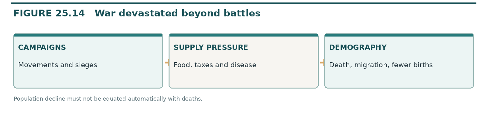

През 1618 г. напрежението над религиозните права и политическата власт в Бохемия помогнало да се предизвика бунт срещу Хабсбургското управление. Пражката дефенестрация се превърна в запомнящ се символ, но войната не може да бъде обяснена с нито един драматичен акт. Бохемският бунт и поражението му бяха последвани от по-широк кръг от конфликти, включващи имперски имоти, Хабсбургите, Дания, Швеция, Франция, Испания и други. Религиозните ангажименти бяха реални, но все повече съюзи отразяваха страховете от династичното и геополитическото господство.

Историците обикновено разделят войната във фазите на Бохемско-Палатин, Датски, Шведски и Френски-Шведски, защото войнствените и стратегически цели се променят. Такива етикети са помощни средства за обучение, а не водонепроницаеми отделения. Густав Адолф от Швеция се намеси през 1630; след смъртта си в Lützen през 1632 войната продължи. Католическата война на Франция срещу Хабсбургските сили от 1635 г. е ясно предупреждение срещу описването на конфликта като проста католическа армия срещу протестантска армия. Логиката на съперничеството с голяма сила може да пресече изповедалнята.

Борбата включваше битки, обсади, принудителни приноси, придвижване на войски, опустошение на културите и повторно преместване. Войските зависели от системите за снабдяване, които поставяли извънредни тежести върху местното население. Някои региони страдаха много повече от други. За да разберем защо войната продължавала, трябва да изследваме военните финанси, съюзите, несигурността на териториите и повтарящите се неуспехи при договарянето на приемливи селища. Религията остава част от конфликта, но не само той поддържа европейските армии в тази област. \[<a href="/025-reformation-and-religious-conflict/sources/#source-21" class="cite">21</a>\]\[<a href="/025-reformation-and-religious-conflict/sources/#source-22" class="cite">22</a>\]

<figure class="figure" id="figure-25-14">

<figcaption>Фигура 25.14. Намаляването на населението не трябва да се сравнява автоматично със смъртта. <a class="figure-anchor" href="#figure-25-14" aria-label="Link to this figure">#</a></figcaption>
</figure>
