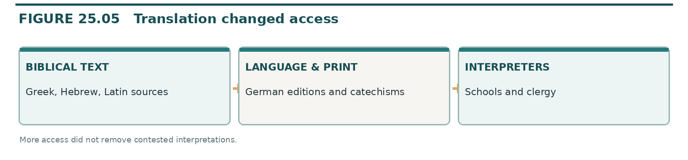

Докато бил подслонен в Уортбърг, Лутер превел Новия завет на немски; той се появил през 1522 г. През 1534 г. последвала една пълна немска Библия, свързана с Лутер и сътрудниците му. Неговата работа привлече към съществуващите немски библейски език и научни традиции, а не изобретяването на народни писания. Решенията за превод били от значение, защото една дума можела да повлияе на доктриналното тълкуване и тъй като читателите от различни региони разбирали речника по различен начин. Стандартизацията е резултат от обучение, печат, администрация и много писатели, а не от една книга магически създаване на национален език.

Новата култура на четене беше неравномерна. Пълните Библии били скъпи; достъпът зависел от грамотността, региона, социалното положение и институциите. Църкви, домакинства и училища използвали по-къси текстове и катехизми, за да предават доктрина. Министрите често тълкували библейските пасажи за слушатели. Протестантските водачи могат едновременно да насърчават достъпа до Писанието и да настояват, че неоторизираните тълкувания заплашват социалния мир. Обещанието за лична ангажираност със свещения текст съществувало заедно със строги граници над онези, които можели да проповядват и да създадат сбор.

Това напрежение илюстрира общ принцип: предоставянето на достъп до информация не премахва споровете относно експертния опит и авторитета. Може да ги умножи. Католическите учени също превеждали, печатали и изучавали Библията. Появата на съперничещи текстови общности направи по-спешно да се разграничи казаното в текста, какво твърдят преводачите и кое правителство или църковно тяло може да наложи това тълкуване. \[<a href="/025-reformation-and-religious-conflict/sources/#source-3" class="cite">3</a>\]\[<a href="/025-reformation-and-religious-conflict/sources/#source-7" class="cite">7</a>\]\[<a href="/025-reformation-and-religious-conflict/sources/#source-8" class="cite">8</a>\]

<figure class="figure" id="figure-25-5">

<figcaption>Фигура 25.5. По-голям достъп не е премахнал спорните тълкувания. <a class="figure-anchor" href="#figure-25-5" aria-label="Link to this figure">#</a></figcaption>
</figure>
