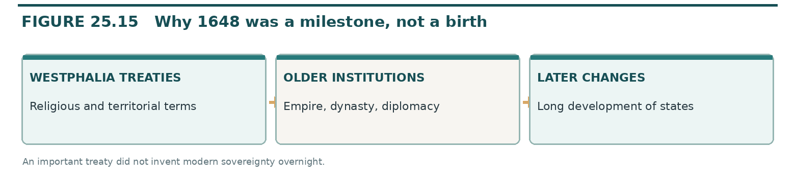

Договорите, сключени в Мюнстер и Оснабрут през 1648 г., обикновено групирани в рамките на Мира на Вестфалия, помогнаха за прекратяване на Тридесетгодишната война в Свещената Римска империя и пренаредени аспекти на европейската дипломация. Те потвърдиха и измениха предишните религиозни договорености, включително признаването на реформираното признание заедно с католицизма и лютеранството в императорската рамка, и договориха права и защита при определени условия. Договорите се отнасят и до територията, правната юрисдикция и отношенията между имперските и чуждите сили.

Вестфалия понякога се описва като единен акт за раждане на съвременната суверенна държавна система: предполага се, че преди 1648 владетели се подчиняват на единна универсална власт и след това всяка държава притежава пълна независимост. Това е исторически подвеждащо. Династически държави, градове, кралства, империи и дипломатически норми са се развивали през вековете; след 1648 Светата Римска империя все още притежава пластови институции и владетели все още се намесват отвъд границите. Договорите имаха голямо значение, без да създават свят на съвременни национални държави за една нощ.

Защо митът продължава? Тя предлага чиста повратна точка за преподаване на комплексни разработки. Но чистите повратни точки могат да скрият векове на приемственост и неравни промени. Един по-силен разказ пита какви конкретни клаузи са защитавали участниците, как по-късно адвокатите тълкували споразуменията и как реалностите на властта оформяли това, което се прилагало. Вестфалия илюстрира повтарящата се тема на книгата: едно събитие може да бъде забележително, без да е източникът на всичко по - късно свързано с нея. \[<a href="/025-reformation-and-religious-conflict/sources/#source-20" class="cite">20</a>\]\[<a href="/025-reformation-and-religious-conflict/sources/#source-21" class="cite">21</a>\]

<figure class="figure" id="figure-25-15">

<figcaption>Фигура 25.15. Един важен договор не е изобретил съвременния суверенитет за една нощ. <a class="figure-anchor" href="#figure-25-15" aria-label="Link to this figure">#</a></figcaption>
</figure>
