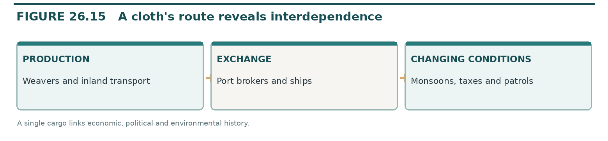

Представете си хипотетична дължина на памучен плат, изтъкан в Западна Индия в началото на шестнадесети век. Един посредник я купува от производител и организира транспорт към брега. Търговец финансира пътуването си през пристанище, където митническите служители оценяват дължимите суми. Платът е опакован на борда на кораб, чийто капитан разчита на сезонни ветрове. В Мелака брокер открива, че купувачите предпочитат определен модел и предлагат по-ниска цена от очакваната. Търговецът решава дали да приеме, съхранява плата, докато пристигне друг флот или го замени за друга стока. Това е учителски случай, а не реконструкция на документирана пратка.

Какво прави платът ценен? Неговото материално качество, цвят и дизайн материя, но така правят предпочитанията на купувача, транспортни разходи, налични заместители, както и способността на търговеца да чака. Ако тя се обменя за пипер, че пипер започва друга серия от сделки, преди да достигне до западните потребители. Следователно пазарът е свързан без всички участници да споделят език, правителство или подробни познания за крайния купувач. Производителят може да бъде засегнат от промяна на цените на хиляди километри, без да разбере защо се е случило.

Сега добавете португалски патрул, изискващ пропуск, началник на пристанището, който променя обичаите и бурята забавя пристигането си. Всяка промяна променя очакваната печалба, без непременно да прекратява търговията. Случаят илюстрира три общи принципа: стоките пътуват през вериги от посредници; политическата власт може да промени стимулите без изцяло да замени пазарите; а един оцелял документ описва само парче от по-големия процес. \[<a href="/026-indian-ocean-commerce-and-asian-powers/sources/#source-4" class="cite">4</a>\]\[<a href="/026-indian-ocean-commerce-and-asian-powers/sources/#source-8" class="cite">8</a>\]\[<a href="/026-indian-ocean-commerce-and-asian-powers/sources/#source-10" class="cite">10</a>\]

<figure class="figure" id="figure-26-15">

<figcaption>Фигура 26.15. Един-единствен товар свързва икономическата, политическата и екологичната история. <a class="figure-anchor" href="#figure-26-15" aria-label="Link to this figure">#</a></figcaption>
</figure>
