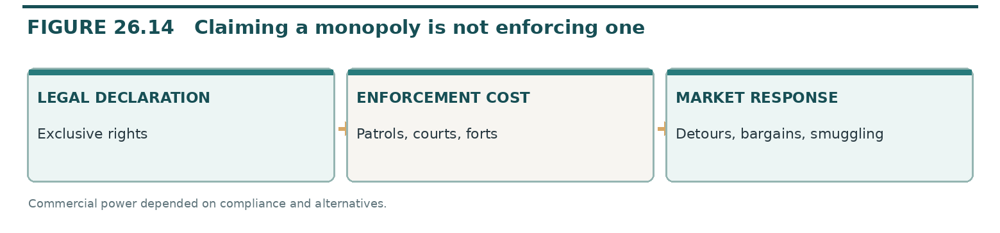

Историите на ранните съвременни империи често се отнасят към монопола като към условие, което веднага следва от декларация на правителството. На практика трябва да се прилагат изключителни права. Длъжностните лица трябва да идентифицират товарите, патрулите, да предотвратят укриването, да осигурят спазването от местните купувачи и да плащат достатъчно персонал, за да направят тази система надеждна. Линийка, която контролира едно пристанище, все още може да се изправи пред конкурентни пристанища и скрити брегове. Дори силните морски държави разчитали на брокери и доставчици, които можели да се пазарят.

Португалските опити за контрол на части от търговията с подправки бяха последващи, но непълни. Въоръжените конфискации и преминаване промениха рисковете и разходите за много търговци, но азиатските търговци продължиха да носят огромни количества стоки. Някои се присъединиха към португалските търговски споразумения, защото това беше печелившо или по-безопасно от съпротивата. Други бягаха, преговаряха или се биеха. Двоичен портрет на героична съпротива срещу абсолютен европейски контрол би пропуснал този променящ се диапазон от избори.

Светът на Индийския океан илюстрира защо икономическата сила е релативна. Кораб с оръдие може да принуди кораба да спре; това не кара тъкачите да произвеждат повече плат или да убедят всички купувачи да приемат цена. Търговските модели зависят от предлагането и търсенето, политическата защита, съществуващите маршрути и възможността за заместване. Мрежата може да бъде силно разрушена, без да се управлява централно. Това разграничение ни подготвя да разберем по-широките корпоративни и колониални проекти от по-късните векове. \[<a href="/026-indian-ocean-commerce-and-asian-powers/sources/#source-2" class="cite">2</a>\]\[<a href="/026-indian-ocean-commerce-and-asian-powers/sources/#source-4" class="cite">4</a>\]\[<a href="/026-indian-ocean-commerce-and-asian-powers/sources/#source-27" class="cite">27</a>\]

<figure class="figure" id="figure-26-14">

<figcaption>Фигура 26.14. Търговията зависи от съответствието и алтернативите. <a class="figure-anchor" href="#figure-26-14" aria-label="Link to this figure">#</a></figcaption>
</figure>
