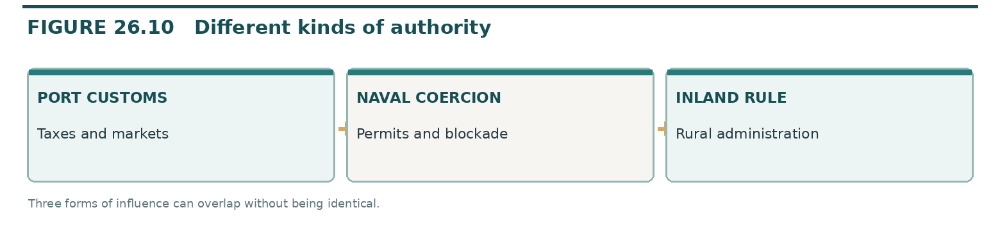

Търговец се сблъскал с няколко вида политическа власт: владетели на пристанища, регионални царства, сухопътни империи, религиозни власти и понякога независими търговски сдружения. Местният владетел може да изисква обичаи, военноморска сила може да изисква разрешение за преминаване и далечен монарх може да претендира за дипломатически приоритет без ежедневни дела. Съвременните карти насърчават едно недоразумение: те рисуват всеки квадрат от територията като принадлежащи изключително на една суверенна държава. Ранните модерни морски власти често били по - пластови.

Управителят на пристанището може да получи приходи, като приветства търговците, вместо физически да притежава корабите. Друга сила може да блокира входа, но не и да принуди жителите да доставят стоки. Дипломатическите подаръци могат да сигнализират за признаване, взаимно предимство или стратегическо представяне, в зависимост от това как участниците ги разбират. Политическият език, преведен през културите несъвършено. Терми като данък, съюз, васалаж и монопол трябва да се използват с внимание към институции и източници, а не се приема, че означава едно и също нещо навсякъде.

Икономическата география направила някои градове привлекателни за завладяване на държави, но пристанищата може да са необичайно трудни за монополизиране, защото търговията можела да се пренасочи. Ефективната власт изискваше съюзи с местните хора, които знаеха маршрутите, доставките и пазарите. Този принцип помага да се обясни защо португалската стратегия за укрепени пристанища би могла да бъде разрушителна, без да превърне Португалия в всесилен собственик на Индийския океан. \[<a href="/026-indian-ocean-commerce-and-asian-powers/sources/#source-3" class="cite">3</a>\]\[<a href="/026-indian-ocean-commerce-and-asian-powers/sources/#source-16" class="cite">16</a>\]\[<a href="/026-indian-ocean-commerce-and-asian-powers/sources/#source-18" class="cite">18</a>\]

<figure class="figure" id="figure-26-10">

<figcaption>Фигура 26.10. Три форми на влияние могат да се припокриват без да са идентични. <a class="figure-anchor" href="#figure-26-10" aria-label="Link to this figure">#</a></figcaption>
</figure>
