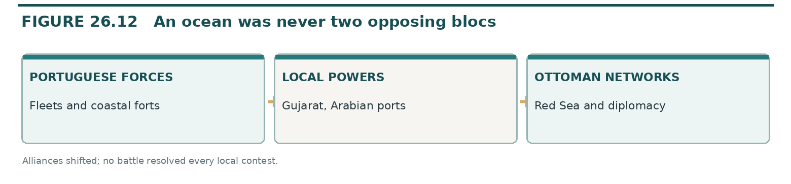

Битката при Диу през 1509 г. даде на португалците важна военноморска победа над коалиция, включваща сили, свързани с Гуджарат, мамлюците и други. Тя помогна за установяването на португалски военен престиж, но не затвори търговията в Червено море или елиминира азиатските конкуренти. Битката понякога е описвана като решаващ контрол над океана от векове; това твърдение значително надхвърля онова, което един флот може да докаже за продължаване на корабоплаването, събирането на данъци и търговските обеми.

След като османците завладяли Египет през 1517 г., те наследили интереси и отговорности, свързани с маршрутите на Червено море и поклонението. Османски кампании, военноморски инсталации и дипломатически отношения, разработени в отговор на португалската дейност и по-широки регионални цели. Османската експедиция срещу Диу през 1538 г. в крайна сметка не успяла да завземе укрепената португалска позиция, но конфликтът не свел западния индийски океан до два еднакви лагера. Управителите на Гуджарати, арабските власти, търговците и крайбрежните популации запазиха важен избор.

По-късните контакти между османските власти и Ачех в Югоизточна Азия показват както ширината на мюсюлманското дипломатическо въображение, така и трудността да се поддържа властта на огромни разстояния. Сметките за артилерийска подкрепа, посолства или съюз се нуждаят от внимателно четене; те не е задължително да създават непрекъснато пряко османско командване в Суматра. Западният океан остава място за договорени коалиции, търговски постоянство и интермитентна война, а не заселване на една победоносна империя. \[<a href="/026-indian-ocean-commerce-and-asian-powers/sources/#source-16" class="cite">16</a>\]\[<a href="/026-indian-ocean-commerce-and-asian-powers/sources/#source-17" class="cite">17</a>\]\[<a href="/026-indian-ocean-commerce-and-asian-powers/sources/#source-28" class="cite">28</a>\]

<figure class="figure" id="figure-26-12">

<figcaption>Фигура 26.12. Съюзите се изместиха; нито една битка не реши всеки местен конкурс. <a class="figure-anchor" href="#figure-26-12" aria-label="Link to this figure">#</a></figcaption>
</figure>
