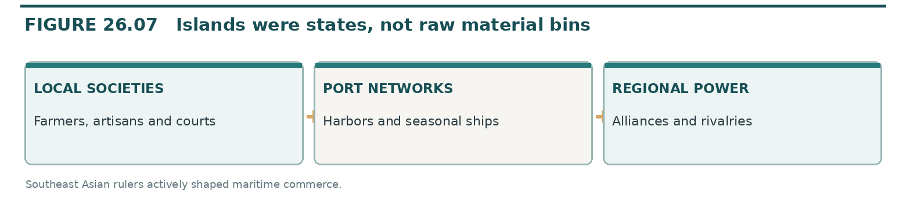

Островите в Югоизточна Азия не бяха разпръснати производители, чакащи чужденците да съберат реколтата си. Java подкрепя популистки общества, селско стопанство, съдилища, религиозни традиции, занаятчийско производство и морска търговия. Маяпахит, влиятелен особено през четиринадесети и началото на петнадесети век, оформя части от архипелага чрез променяща се смесица от военни кампании, престиж, приточни отношения и местни съюзи. Твърденията за териториалното му измерение изискват грижи: по-късните карти понякога оцветяват обширен регион, сякаш се управлява като модерна държава-членка.

Архипелагът доставял продукти, силно търсени другаде, особено пипер, ароматни гори и подправки, свързани с определени острови. Но корабите също пренасяли зърно, керамика, дървен материал и текстил между съседните общности. Политическата власт може да възникне от контрола върху селскостопанските популации, както и от облагането на морския обмен. Местните управници преценяват кога да посрещат чужди търговци, да защитават пристанище или да отклоняват търговията към собствените си съюзници.

С течение на времето ислямските съдилища и търговски общности придобиха влияние в части от морската Югоизточна Азия, докато хинду-будистките практики продължиха другаде и останаха важни за културната история. Нямаше нито един момент, в който цял регион да "преобразува." Реализациите, търговските възможности, династичната политика, религиозното обучение и избора на домакинство взаимодействаха по различни начини на Суматра, Ява и други острови. Наличието на джамии, надписи и променящи се съдебни традиции документира историческа трансформация, но също така оставя много за обикновения живот неизвестен. \[<a href="/026-indian-ocean-commerce-and-asian-powers/sources/#source-1" class="cite">1</a>\]\[<a href="/026-indian-ocean-commerce-and-asian-powers/sources/#source-12" class="cite">12</a>\]\[<a href="/026-indian-ocean-commerce-and-asian-powers/sources/#source-22" class="cite">22</a>\]

<figure class="figure" id="figure-26-7">

<figcaption>Фигура 26.7. Управляващите от Югоизточна Азия активно оформиха морската търговия. <a class="figure-anchor" href="#figure-26-7" aria-label="Link to this figure">#</a></figcaption>
</figure>
