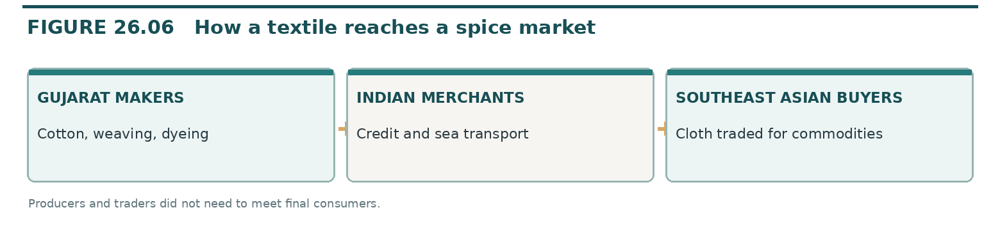

На югозападното крайбрежие на Индия пристанищата Малабар били известни с пипера и с търговците от много среди. Каликът, свързан с владетеля, често наричан Заморин, станал важен център на търговията и дипломацията. В близост до Cochin и други пристанища се конкурираха и съдействаха в рамките на областните правомощия. Тази политическа множественост имаше значение, когато европейците пристигнаха: новодошлите можеха да търсят съюз на един владетел срещу друг, докато местните управници можеха да използват чужди кораби за собствените си цели.

Пепър има местни корени в земеделието, труда и екологичните условия. Стойността на стоката в чужбина не трябва да ни кара да забравяме производителите, наема за земя, брокерите и транспорта от производствените райони до пристанищните складове. Богатството на търговски град е оформено от връзките му с производството и от това колко надеждно би могло да получи купувачи, да претегля стоки, да урежда спорове и продоволствени кораби. Ривалните пристанища понякога придобивали бизнес, когато войните или данъците правели още по - малко привлекателни.

Разказите, написани от ранните португалски посетители, разкриват очарование и понякога недоразумение. Те предоставят доказателства за европейски очаквания, военни цели и наблюдения, но не могат да бъдат разглеждани като неутрални проучвания на индийското общество. Някои писатели не разбирали местните религиозни обичаи или търговски обичаи. Сравняването на европейските записи с регионални текстове, материални доказателства и по-късна стипендия не позволява първото чуждо описание да се превърне в цялата история на процъфтяващото крайбрежие. \[<a href="/026-indian-ocean-commerce-and-asian-powers/sources/#source-2" class="cite">2</a>\]\[<a href="/026-indian-ocean-commerce-and-asian-powers/sources/#source-6" class="cite">6</a>\]\[<a href="/026-indian-ocean-commerce-and-asian-powers/sources/#source-20" class="cite">20</a>\]

<figure class="figure" id="figure-26-6">

<figcaption>Фигура 26.6. Производителите и търговците не трябваше да се срещат с крайните потребители. <a class="figure-anchor" href="#figure-26-6" aria-label="Link to this figure">#</a></figcaption>
</figure>
