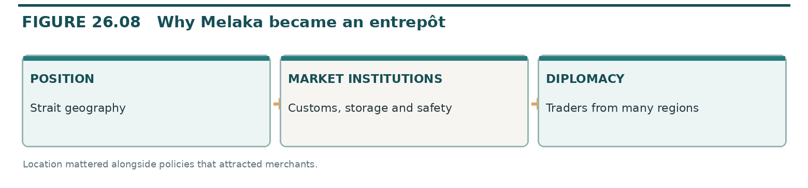

Мелака, на полуостров Малайския полуостров, се издига до известност през петнадесети век, защото е добре разположен близо до пролива, свързващ Индийския океан с Южнокитайско море. Неговите управници развивали отношения с търговци от много региони и се възползвали от условията, които насърчавали обмена. Пристанището не било богато само защото корабите били принудени да плават покрай него. Един успешен entrepôt необходими органи в състояние да координират пазарите, събиране на данъци, намаляване на някои видове несигурност и позволява на хората с различен произход да търгуват.

Султанатът Мелака развива дипломатически връзки с Китай Мин и участва в мрежи от мюсюлмански търговци и учени. Нейните съдилища и правни обичаи са се развили в космополитна обстановка, но би било грешка да се опише всеки обитател като споделящ една и съща културна идентичност. Индийски, китайски, малай, Javanese и други общности взаимодействат в различни професионални и социални позиции. Пратка индийска кърпа може да бъде разменена за подправки, които след това могат да продължат към Китай или западните пазари.

През 1511 г. португалците от Афонсо де Албакърки завладяват пристанищния град. Това не означавало, че всеки кораб впоследствие преминал послушно през португалските обичаи. Някои търговци предпочитали алтернативни места, включително Аеш и Йохор, и конкурентните маршрути придобили значение. Значението на Мелака като кръстопът оцелява след политическа промяна, докато въздействието върху неговото търговско население беше значително и неравномерно. Днес ЮНЕСКО признава дългата си мултикултурна история, но модерен списък на наследството не може да замени сложната история на определени общности от XV и XVI век. \[<a href="/026-indian-ocean-commerce-and-asian-powers/sources/#source-12" class="cite">12</a>\]\[<a href="/026-indian-ocean-commerce-and-asian-powers/sources/#source-22" class="cite">22</a>\]\[<a href="/026-indian-ocean-commerce-and-asian-powers/sources/#source-24" class="cite">24</a>\]

<figure class="figure" id="figure-26-8">

<figcaption>Фигура 26.8. Мястото е от значение заедно с политиките, които привличат търговците. <a class="figure-anchor" href="#figure-26-8" aria-label="Link to this figure">#</a></figcaption>
</figure>
