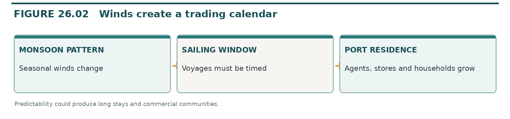

Мусонът е сезонен модел на ветрове и валежи, движени от променящото се отопление на сушата и морето и от по-голямата атмосферна циркулация. В общи линии югозападните ветрове са склонни да доминират по-голямата част от северния индийски океан през бурното лято, докато североизточните ветрове стават важни през зимата. Точното време, морски условия и посока се различават значително по региона. Затова моряците се нуждаели от местни познания, а не само от правило "Пътуване на изток през лятото и на запад през зимата."

Мусоните правели пътешествията по-предсказуеми, но също така създали и чакане. Ако капитан пристигне след сезонно напускане, екипажът може да остане в пристанище с месеци. Това беше скъпо, но наложената пауза помогна за създаването на местни търговски общности. Търговци установени агенти, съоръжения за съхранение, бракове, покровителски отношения и правни методи за решаване на спорове. Търговските календари също така оформиха приходите на управляващите: пристанище, което предлага безопасно закрепване, доставки и надежден обмен, може да привлече флотилии през краткия търговски сезон.

Един полезен показател илюстрира значението на времето. Представете си същия текстил, подправки и нетърпеливи купувачи, но няма ветрове, които могат да се очакват от година на година. Вояжите щяха да са изправени пред много по-голяма несигурност и капитал можеше да останат по-близо до дома. Знанията на мусоните намалиха известна несигурност, без да премахват бури, пиратство, изместване на пясъчните брегове или навигационни грешки. Това е форма на натрупани практически науки, предавани чрез квалифицирани морски лица и пристанищни общности през поколенията. \[<a href="/026-indian-ocean-commerce-and-asian-powers/sources/#source-1" class="cite">1</a>\]\[<a href="/026-indian-ocean-commerce-and-asian-powers/sources/#source-3" class="cite">3</a>\]\[<a href="/026-indian-ocean-commerce-and-asian-powers/sources/#source-5" class="cite">5</a>\]

<figure class="figure" id="figure-26-2">

<figcaption>Фигура 26.2. Предсказуемостта може да доведе до дълъг престой и търговски общности. <a class="figure-anchor" href="#figure-26-2" aria-label="Link to this figure">#</a></figcaption>
</figure>
