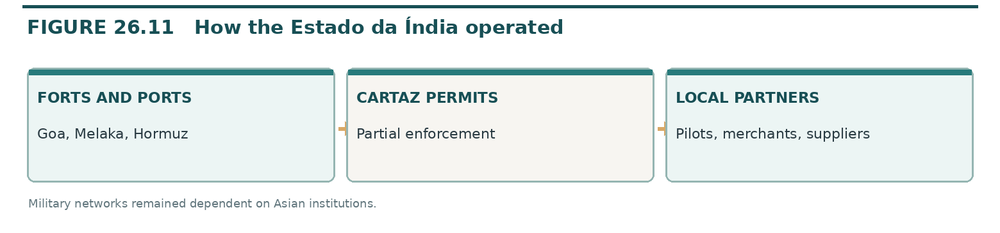

През шестнадесети век португалските власти се опитват да осигурят стратегически позиции, включително Гоа, заловени през 1510 г., и Мелака през 1511 г.; Хормуз става ключов аванпост през 1515 г. Estado da Índia е разпръсната рамка от укрепления, длъжностни лица, селища и морски искове, а не компактна територия, покриваща цяла Индия. Нейната военноморска сила и административна амбиция са били реални, но областите, в които полицията може да бъде ограничена от разстояние, разходи, съпернически сили и местна политика.

Картазовата система, често описвана като режим на морски проходи, се стреми да изиска някои доставки, за да получи разрешение от Португалия под заплаха от конфискация. Нейните правила и прилагане варират в различните маршрути и периоди. Това беше усилие за извличане на приходи и упражняване на контрол върху корабоплаването, а не доказателство, че всеки азиатски търговец прие португалско господство. Някои пътувания избягвали патрулите, поели алтернативни маршрути, договорили специално третиране или пренасяли стоки на португалски кораби. Европейските и азиатските актьори могат да си сътрудничат и да се борят.

Португалците понякога укрепват конкурентните пристанища, като се опитват да повредят традиционните ентрепоти. Те също зависели от местните финансисти, пилоти, търговци и работници. Такава зависимост усложнява триумфалния език за овладяването на цял океан. Военното предимство при тесен подход не се равнявало на производството на памучен плат, доставката на храна на всяко пристанище или командването на огромно население във вътрешността. В резултат на това търговската поръчка остава хибридна и оспорвана. \[<a href="/026-indian-ocean-commerce-and-asian-powers/sources/#source-2" class="cite">2</a>\]\[<a href="/026-indian-ocean-commerce-and-asian-powers/sources/#source-18" class="cite">18</a>\]\[<a href="/026-indian-ocean-commerce-and-asian-powers/sources/#source-27" class="cite">27</a>\]

<figure class="figure" id="figure-26-11">

<figcaption>Фигура 26.11. Военните мрежи останаха зависими от азиатските институции. <a class="figure-anchor" href="#figure-26-11" aria-label="Link to this figure">#</a></figcaption>
</figure>
