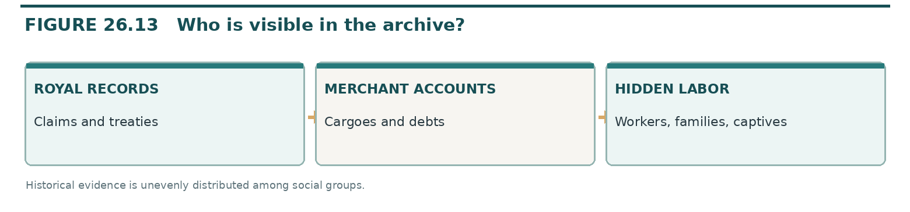

Поробването е част от по-широкия индийски океански свят, включително формите на битова услуга, военната зависимост, морския транспорт и труда в определени региони. Индивидуалните лица бяха насилствено изселени по крайбрежието и вътрешните пътища; някои бяха подложени на тежко насилие и трайна загуба на свобода. Институциите се различават по място и период, а доказателствата са неравни. Не бива нито да минимизираме принуда, като отбележим, че робството приема различни форми, нито да сравняваме всяка институция от Индийския океан механично с системата за плантация на Атлантическия океан, изучавана в глава 29.

Религиозният закон, войните, дългът, пленът и комерсиалното търсене могат да повлияят на пътищата за поробване. Свободните и несвободни хора понякога пътували на един и същ кораб, но техният опит не може да се слее в празнична история за културен обмен. Принудителният емигрант може да носи език, умения и вяра в далечното домакинство, като няма избор в пътуването. Културното предаване не е доказателство за свобода или съгласие.

Историците са особено предпазливи относно количествените твърдения. Оцелелите регистри не обхващат всяко пътуване, а по-късните периоди могат да бъдат документирани много по-пълно от предишните. Масивната търговия от деветнадесети век, свързана с Източна Африка, Арабския полуостров и островите в Индийския океан, не може просто да се приеме, че е действала по еднакъв начин през 1500 г. Отговорният разказ посочва известни практики, признава липсващи доказателства и поддържа човешкото страдание видимо дори когато общият брой продължава да бъде оспорен. \[<a href="/026-indian-ocean-commerce-and-asian-powers/sources/#source-13" class="cite">13</a>\]\[<a href="/026-indian-ocean-commerce-and-asian-powers/sources/#source-14" class="cite">14</a>\]\[<a href="/026-indian-ocean-commerce-and-asian-powers/sources/#source-30" class="cite">30</a>\]

<figure class="figure" id="figure-26-13">

<figcaption>Фигура 26.13. Историческите доказателства се разпространяват неравномерно сред социалните групи. <a class="figure-anchor" href="#figure-26-13" aria-label="Link to this figure">#</a></figcaption>
</figure>
