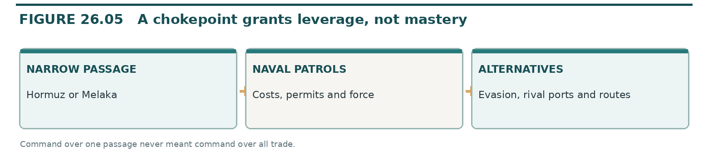

Персийският залив свързва морето с иранските, арабските и месопотамските пазари. Хормуз става основен търговски център заради географията, политическата защита, финансите и позицията си в близост до залива. Търговците могат да свържат морските товари с вътрешните пътища към Иран и отвъд него. Пристанищата в Залива се занимаваха със стоки, включително коне, перли, текстил и продукти, които вече бяха преминали през няколко посредници. Управителят на пристанище може да печели пари, като облага стоки, вместо да ги притежава.

Политическата сцена беше сложна. Местните управници преговаряха с конкурентни регионални сили, включително държави в Иран и Арабия; търговците преследваха собствените си интереси и можеха да сменят пристанищата, когато условията се променят. Когато португалците в крайна сметка си осигурили командирска позиция в Хормуз в началото на шестнадесети век, това не било просто прехвърляне от "азиатската свобода" към "европейски контрол." Тя обгради новите военни и фискални изисквания по отношение на по-старите договорености, а границите на португалското прилагане оставаха важни.

Наричането на Хормуз "шокпойнт" е полезно само ако уточним какво всъщност може да бъде контролирано. Боен кораб в устата на залива може да застраши корабоплаването. Тя не може непременно да принуждава търговците да използват определен склад, да предотвратяват контрабандата или да премахват заместителите на пазарите. Географията дава предимство, а не всемогъщество. Това разграничение между позиционно предимство и ефективна политическа власт ще се повтори в Гоа, Мелака и Червено море. \[<a href="/026-indian-ocean-commerce-and-asian-powers/sources/#source-2" class="cite">2</a>\]\[<a href="/026-indian-ocean-commerce-and-asian-powers/sources/#source-3" class="cite">3</a>\]\[<a href="/026-indian-ocean-commerce-and-asian-powers/sources/#source-18" class="cite">18</a>\]

<figure class="figure" id="figure-26-5">

<figcaption>Фигура 26.5. Командването над един пасаж никога не е означавало командване над цялата търговия. <a class="figure-anchor" href="#figure-26-5" aria-label="Link to this figure">#</a></figcaption>
</figure>
