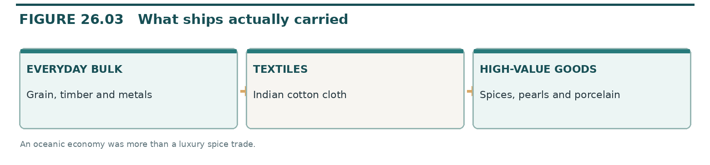

Историите за "търговията на подправките" могат да накарат търговията в Индийския океан да звучи като размяна на луксозни подправки сред богатите потребители. Пепър, карамфил, индийско орехче, боздуган и канела са от голямо значение, но текстилът е бил централен за много вериги. Индийски памучен плат варира от обикновена, относително евтина тъкан до фино моделирани и боядисани продукти. Търговците носеха плат на африканските и югоизточните азиатски пазари, където дизайните, цветовете, измерванията и качеството често трябваше да отговарят на местните предпочитания.

Други стоки включват ориз, пшеница, захар, дървен материал, метали, коне, керамика, перли, медицински вещества, тамян и ежедневни домакински предмети. Насипните стоки осигурявали храна и материали за градовете и корабите; специалните продукти правели някои пътувания особено печеливши. Голямо количество обикновена стока може да бъде по-важно за икономиката, отколкото малка пратка, която командва грандиозни цени. Китайският порцелан например е пътувал на дълги разстояния и оцелява в археологически разкопки отчасти, защото огънят по керамиката се запазва добре. Това не означава, че всеки пътешественик е притежавал порцелан или грънчарство само по себе си измерва обема на търговията.

Пазарите работиха чрез заместване и промяна на вкусовете. Купувачът може да отхвърли модел плат, който е предпочитан другаде, докато владетелят, търсещ конни коне, може да плати премия за надеждни вносни животни. Задачата на историка е да попита не просто "Какво е било търгувано?" а "Кой го е произвел, защо друг регион го цени и кои институции събраха двете заедно?" \[<a href="/026-indian-ocean-commerce-and-asian-powers/sources/#source-4" class="cite">4</a>\]\[<a href="/026-indian-ocean-commerce-and-asian-powers/sources/#source-8" class="cite">8</a>\]\[<a href="/026-indian-ocean-commerce-and-asian-powers/sources/#source-9" class="cite">9</a>\]

<figure class="figure" id="figure-26-3">

<figcaption>Фигура 26.3. Океанската икономика била нещо повече от луксозна търговия с подправки. <a class="figure-anchor" href="#figure-26-3" aria-label="Link to this figure">#</a></figcaption>
</figure>
