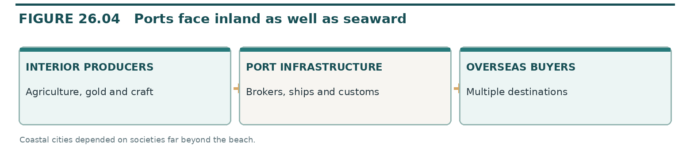

От северното кенийско крайбрежие до днешна Танзания и по-на юг, говорещите суахили общности развиват градски и морски култури, които свързват африканските нинтерланди с външната търговия. Градове като Килва, Момбаса и Малинди черпиха сила от своите местни политически мрежи, риболов, занаятчийско производство, селско стопанство и търговски контакти. Тяхната архитектура, джамии, монети и вносна керамика свидетелстват за трайно ангажиране с по-широкия океан. Но обществата, които са построили тези пристанища, са били африкански общности, а не чужди колонии са паднали на друг празен бряг.

Отвъдморските връзки повлияли на материалната култура и религия. Ислямът става важен в много крайбрежни общности и връзките с Арабия, Персия и Индия оформят някои стилове и институции. Езикът, наречен сега Суахили, е Банту в граматическите му основи, въпреки че съдържа важен назаем речник. Наричайки Суахили цивилизацията просто "Араб" допуска грешки в културния контакт за произхода на самите хора. Историците съчетават археология и местни доказателства с разкази, написани от пътешественици, чиито решения отразяват непознати очаквания.

Просперирането на пристанището също почиваше върху вътрешните отношения и би могло да включва насилие или експлоатация. Злато, слонова кост и други стоки, придвижвани към крайбрежните пазари от региони, свързани с търговци и политически посредници. Търговията с роби също беше част от историята на Индийския океан, макар че мащабът му, маршрутите и институциите се промениха с течение на времето. Не трябва да проектираме огромната търговия с роби през 19-ти век в Източна Африка, която е непроменена към петнадесети век. Разбирането на агенцията на Африка означава признаване на нейните търговски постижения без изтриване на принуда. \[<a href="/026-indian-ocean-commerce-and-asian-powers/sources/#source-13" class="cite">13</a>\]\[<a href="/026-indian-ocean-commerce-and-asian-powers/sources/#source-14" class="cite">14</a>\]\[<a href="/026-indian-ocean-commerce-and-asian-powers/sources/#source-15" class="cite">15</a>\]

<figure class="figure" id="figure-26-4">

<figcaption>Фигура 26.4. Крайбрежните градове зависели от обществата отвъд плажа. <a class="figure-anchor" href="#figure-26-4" aria-label="Link to this figure">#</a></figcaption>
</figure>
