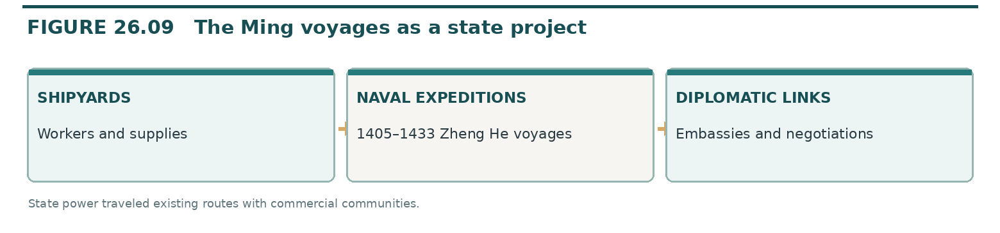

От 1405 до 1433 г. флоти, командвани от Джън Хе и колеги, предприемат седем големи пътувания през Югоизточна Азия и Индийския океан. Експедициите посетиха важни търговски пристанища в Южна Азия и техните маршрути в крайна сметка се разшириха до Персийския залив и източноафриканския бряг. Съвременните записи, надписи и по-късни компилации документират тяхното дипломатично и морско значение, въпреки че точните размери на флота и някои сензационни описания на огромни кораби остават дискутирани.

Това не били просто мирни круизи или прости пътешествия в един непознат свят. Авиокомпанията е работила по съществуващи маршрути и е посещавала опитни търговски общества. Представители на Минг предложиха подаръци, получиха пратеници и потърсиха политическо признание. Понякога силата придружаваше дипломацията, както и интервенциите, засягащи регионалните конфликти. Впечатляващият капацитет на държавата да мобилизира кораби и персонал зависи от корабостроителни центрове, квалифицирани работници, провизии и скъпоструваща администрация. Това беше форма на императорска проекция, вкоренена в местните ресурси на Китай.

По-късното намаляване на такива огромни официални пътувания често се разказва като доказателство, че Китай "се е отклонил от морето." Това е твърде просто. Съдебни приоритети, фискални разходи, сигурност на северната граница, различни политики по отношение на частната търговия и местната икономическа дейност са от значение. Морската борса не изчезна, когато гигантските флотилии спряха да плават. Полезно сравнение с по-късните португалски експедиции пита дали различните държавни проекти са предназначени за събиране на данък, създаване на търговски станции, налагане на изключителна търговия или постигане на повече от един от тези проекти едновременно. \[<a href="/026-indian-ocean-commerce-and-asian-powers/sources/#source-5" class="cite">5</a>\]\[<a href="/026-indian-ocean-commerce-and-asian-powers/sources/#source-25" class="cite">25</a>\]\[<a href="/026-indian-ocean-commerce-and-asian-powers/sources/#source-26" class="cite">26</a>\]

<figure class="figure" id="figure-26-9">

<figcaption>Фигура 26.9. Държавната енергия е пътувала по съществуващи маршрути с търговски общности. <a class="figure-anchor" href="#figure-26-9" aria-label="Link to this figure">#</a></figcaption>
</figure>
