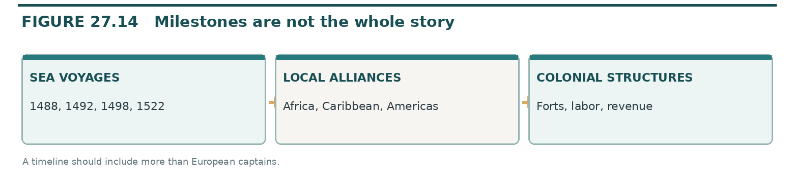

Няколко дати закрепят главната последователност. През 1415 г. португалските сили превзеха Сеута. Португалското атлантическо селище се разшири през Мадейра и Азорските острови през петнадесети век; контактът и насилието се развиха по западните африкански брегове. През 1482 г. е създадена крепост Елмина. Диас закръгля носът през 1488 г. Колумб достига Карибите през 1492 г.; Португалия и Кастилия се съгласяват с Договора от Тордесиляс през 1494 г.; да Гама достига Каликът през 1498 г.; а Кабрал достига Бразилия през 1500 г. \[<a href="/027-european-maritime-expansion/sources/#source-1" class="cite">1</a>\]\[<a href="/027-european-maritime-expansion/sources/#source-3" class="cite">3</a>\]\[<a href="/027-european-maritime-expansion/sources/#source-6" class="cite">6</a>\]

В 1507 Waldseemüller карта използва името Америка. Експедицията на Магелан отпътува през 1519 г.; коалицията на Кортес превзе Тенохтитлан през 1521 г.; а оцелелият екипаж на Елкано завърши обиколката си през 1522 г. Припадъкът на Писаро от Атахуала се е появил през 1532 г. Испанският път за връщане през Тихия океан се развива през 1565 г., а Манила става колониален център през 1571 г. Тези дати помагат да се подредят събитията, но те не описват едновременната трансформация във всяко свързано общество. \[<a href="/027-european-maritime-expansion/sources/#source-2" class="cite">2</a>\]\[<a href="/027-european-maritime-expansion/sources/#source-21" class="cite">21</a>\]\[<a href="/027-european-maritime-expansion/sources/#source-25" class="cite">25</a>\]

Хронологията сама по себе си може да бъде заблуждаваща, ако всяка линия назове само европейски командир. Наред с пътешествията се намираха африканските царства, обществата Таино, мезоамериканските коалиции, Андските поляци, индийските пристанищни градове и тихоокеанските островни общности. Оформили са това, което се е случило, въпреки че конвенционалните експедиции не ги назовават. По-добра времева линия проследява срещи, съпротива и институционално изграждане, както и заминаване на кораби.

<figure class="figure" id="figure-27-14">

<figcaption>Фигура 27.14. Времевата линия трябва да включва повече от европейските капитани. <a class="figure-anchor" href="#figure-27-14" aria-label="Link to this figure">#</a></figcaption>
</figure>
