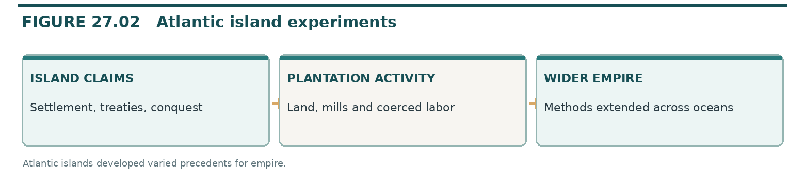

Конфискацията на Португалия в Сеута през 1415 г. често се разглежда като ранен маркер за разширяване, въпреки че Сеута е северноафриканско пристанище със собствена установена история. През следващите десетилетия португалското селище се развиваше на Мадейра и Азорските острови; Канарските острови станаха арена на завладяването на Кастилия, в която коренните Гуанчеви общности се съпротивляваха и понесоха разпадане и робство. По-късно Кабо Верде и Сао Томе и Принсипи станаха важни за търговията и селището в Атлантическия океан. Опитите на островитяните се различавали значително: някои острови нямали постоянно човешко население, когато европейците създали колонии, докато други вече били обитавани. \[<a href="/027-european-maritime-expansion/sources/#source-6" class="cite">6</a>\]\[<a href="/027-european-maritime-expansion/sources/#source-10" class="cite">10</a>\]\[<a href="/027-european-maritime-expansion/sources/#source-11" class="cite">11</a>\]

Тези атлантически предприятия предоставят практика при организирането на сетълмент, разпространението на земя, данъчно облагане на търговията и производството на експортни култури. Отглеждането на захар от Мадейра и системите за плантация, разработени на Атлантическите острови, помогнаха да се създадат техники, които по-късно се разшириха в Америка. Историята на плантацията включваше сложни подредби на земя, капитал, мелници и труд, включително робство и принуда. Глава 29 ще изследва растежа на Атлантическо робство в много по-голяма дълбочина. \[<a href="/027-european-maritime-expansion/sources/#source-10" class="cite">10</a>\]\[<a href="/027-european-maritime-expansion/sources/#source-11" class="cite">11</a>\]

Историята на острова има значение, защото по-късно завоеванието не е измислено през 1492 г. Експедициите са натрупали опит в продължение на няколко поколения: как да се пазарим за финансова подкрепа, да разпределяме имущество, да наемаме или принуждаваме работници и да изграждаме институции далеч от метрополитическия съд. Опитът обаче не гарантира успех, а последиците за колонизираните народи не са само технически "уроки" за европейските администратори.

<figure class="figure" id="figure-27-2">

<figcaption>Фигура 27.2. Атлантическите острови създали различни прецеденти за империята. <a class="figure-anchor" href="#figure-27-2" aria-label="Link to this figure">#</a></figcaption>
</figure>
