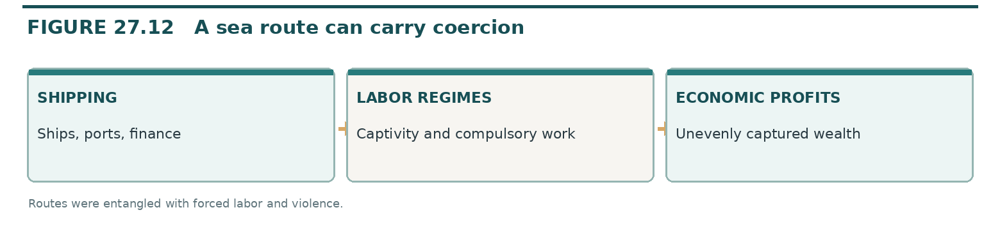

Португалските пътешествия и системите за плантация на Атлантическия остров помогнаха за развитието на институции, които ще се хранят с по-късния трансатлантически трафик на поробени африканци. Поробването е съществувало в много общества преди европейските атлантически предприятия, но този фон не може да оправдае новия мащаб, маршрутите и търговската организация на системата на Атлантическия океан. Хората били заловени, закупени, транспортирани и принудени да работят под насилие и лишения. Африканските общества изпитват различни политически и социални последици, включително конфликти и съпротива. \[<a href="/027-european-maritime-expansion/sources/#source-15" class="cite">15</a>\]\[<a href="/027-european-maritime-expansion/sources/#source-16" class="cite">16</a>\]

Ранните фази на тази система все още не приличат на пълната ѝ степен от 17-ти и 18-ти век. Отличителните периоди избягват грешката да се проектира по-късна структура назад непроменена. В същото време, наричайки едно ранно начинание просто "търговия" крие моралния и исторически факт, че хората са третирани като стоки. Внимателно терминологията има значение. \[<a href="/027-european-maritime-expansion/sources/#source-15" class="cite">15</a>\]\[<a href="/027-european-maritime-expansion/sources/#source-16" class="cite">16</a>\]

Глава 29 ще разгледа директно атлантическите икономики за търговия с роби и плантации, включително ролите на европейските държави и търговци, африкански политически участници, съпротива и премахване. Точката тук е структурна: разширяването в морето отвори икономическите възможности и принудителните трудови режими станаха съществена част от начина, по който някои от тези възможности бяха реализирани. История, която се интересува само от кораби и подправки е непълна.

<figure class="figure" id="figure-27-12">

<figcaption>Фигура 27.12. Пътищата били заплетени с принудителен труд и насилие. <a class="figure-anchor" href="#figure-27-12" aria-label="Link to this figure">#</a></figcaption>
</figure>
