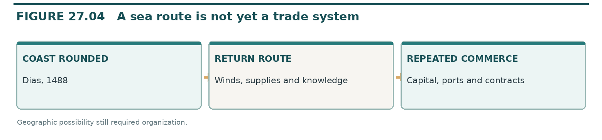

През 1488 г. Бартоломей Диас заобля Южна Африка, което показва, че Атлантическият и индийските океани могат да бъдат свързани по море през маршрута на Кейп. Пътешествието, построено на десетилетия напредък на юг и натрупани познания за условията на плаване. Диас не е създал веднага печеливш маршрут до Индия; той остава необходим за организиране на кораби и доставки, договаряне на срещи по непознат бряг и навигация в западния индийски океан. \[<a href="/027-european-maritime-expansion/sources/#source-1" class="cite">1</a>\]\[<a href="/027-european-maritime-expansion/sources/#source-6" class="cite">6</a>\]

Океанският маршрут изисква и обратно пътуване. Кораб, който достига дестинация, но не може да отплава безопасно, произвежда малко устойчива търговия. Пътешествието в Кейп разкри географска възможност, докато повдигаше нови практически проблеми: къде да се получи вода, как да се управлява скорбут и други болести, как да се комуникира с крайбрежните жители и кои сезонни ветрове биха могли да пренасят кораб през Индия. Следователно оптимистичната фраза "открит маршрут" е само началото на една по-голяма икономическа история.

Мястото на Диас в историята е сигурно без разкрасяване. Не е нужно да си представяме всяка дума на експедицията или точната драма на борда, за да разберем важността й. Много познати сцени на щурмовани капитани и важни речи идват от по-късните предричания. Най-силното историческо обяснение е скромно и по-впечатляващо: експедицията потвърди плавателна географска връзка, която последвалите моряци и правителства могат да изградят в повтарящи се пътувания.

<figure class="figure" id="figure-27-4">

<figcaption>Фигура 27.4. Geographic възможност все още изисква организация. <a class="figure-anchor" href="#figure-27-4" aria-label="Link to this figure">#</a></figcaption>
</figure>
