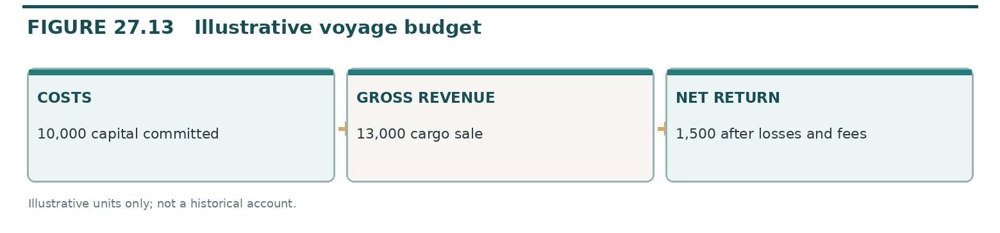

Да разгледаме едно изобретено пътуване, финансирано с 10 000 броя капитал. Корабите и ремонтите изискват 3000; заплатите и провизиите 2,500; кредитните и пристанищните такси 1000; въоръжената защита 1500; и резерв за неочаквани разходи 2000. Предприятието трябва да се възстанови повече от 10 000-те, поети преди инвеститорите му да реализират нетна печалба. Ако един товар се продава за 13,000, но 1,500 са загубени за разваляне и допълнителни такси, очевидната печалба от 3,000 намалява до 1,500 преди други задължения. Тези числа са илюстративни, а не исторически. \[<a href="/027-european-maritime-expansion/sources/#source-18" class="cite">18</a>\]

Сега си представи двама инвеститори. Единият иска високо ценен товар, който се продава в Европа, а другият иска укрепена крайбрежна позиция, която да подкрепи поредица от бъдещи пътувания. Първият оценява незабавната печалба; вторият разглежда бъдещите митнически приходи, стратегическия ливъридж и разходите за поддръжка. Управителят може да цени политическия престиж дори когато предприятието не плаща. Екипажът може да оцени заплатите и оцеляването, докато местният владетел може да прецени дали пускането на корабите в пристанището би укрепило съперника. Следователно същата експедиция може да бъде оценена много по-различно от актьорите с различни стимули.

Това упражнение обяснява защо фразата "Португалия стана богат от откритие" е твърде неясна, за да се научи много. Кой е спечелил, кога, от каква дейност и на чия цена? Едно печелившо търговско пътуване не е идентично с положителния данъчен резултат за държавата, все още по-малко до по-добри условия на живот за всички в обществото.

<figure class="figure" id="figure-27-13">

<figcaption>Фигура 27.13. Само илюстративни единици, а не историческа сметка. <a class="figure-anchor" href="#figure-27-13" aria-label="Link to this figure">#</a></figcaption>
</figure>
