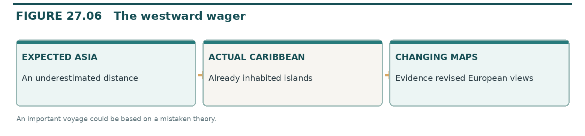

Христофор Колумб, пехотинец от Genoese, който осигурил подкрепа от Кастилската корона, предложил да стигне до Азия чрез плаване на запад през Атлантическия океан. Образованите европейци обикновено приемали, че Земята е сферична; централният спор не бил дали един кораб ще падне от ръба си, а колко далеч ще трябва да пътува и колко океани са отделили Европа от Азия. Колумб силно подценил разстоянието до Азия и не разбрал географията. Неговият успех в достигането на земята не трябва да се бърка с това, че е прав за предназначението на маршрута. \[<a href="/027-european-maritime-expansion/sources/#source-2" class="cite">2</a>\]\[<a href="/027-european-maritime-expansion/sources/#source-3" class="cite">3</a>\]\[<a href="/027-european-maritime-expansion/sources/#source-19" class="cite">19</a>\]

През 1492 г. три кораба прекосили Атлантическия океан от Канарските острови и стигнали до Бахамите, където Колумб срещнал Таино говорещи островитяни. Той вярвал, че е стигнал до островите, свързани с Индия. Думата "Индианци," приложена към коренните американски народи, е нараснала от тази погрешна география и оцелява в много исторически документи; тя никога не трябва да означава, че хората всъщност идват от Южна Азия. Колумб продължавал да прави няколко пътувания, установявайки претенции и селища, които бързо трансформирали Карибите. \[<a href="/027-european-maritime-expansion/sources/#source-2" class="cite">2</a>\]\[<a href="/027-european-maritime-expansion/sources/#source-19" class="cite">19</a>\]

Историческото значение на пресичането е огромно, защото то започва да поддържа все по-последователен европейски-американски контакт под разширяващата се испанска монархия. Това не било първото човешко присъствие в Америка и дори не било първото известно европейско кацане там: скандинавските пътешественици достигнали североизточна Северна Америка векове по-рано. Нейната важност е трайността, мащабът и държавната подкрепа на последващите трансатлантически връзки, а не магическо "първо откритие" на населено полукълбо.

<figure class="figure" id="figure-27-6">

<figcaption>Фигура 27.6. Едно важно пътуване може да се основава на грешна теория. <a class="figure-anchor" href="#figure-27-6" aria-label="Link to this figure">#</a></figcaption>
</figure>
