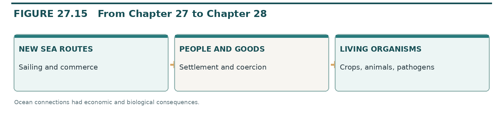

Морското разширяване означава развитието на трайни пътувания в чужбина, търговски отношения, териториални претенции и институции за контрол. Carravel е сравнително маневрен плавателен съд, използван в някои иберийски предприятия; каррак или нау се отнася до по-големи океански плавателни съдове, които могат да носят значителни товари. Volta do mar описва маршрутни пътувания с цел използване на вятърни и токови системи в Атлантическия океан. Мъртво отчитаща позиция с помощта на посока, скорост и изминало време. Entrepôt е търговско пристанище, където стоките се събират и преразпределят. \[<a href="/027-european-maritime-expansion/sources/#source-5" class="cite">5</a>\]\[<a href="/027-european-maritime-expansion/sources/#source-8" class="cite">8</a>\]

Договорът от Тордесилски се отнася до споразумението от 1494 г., което разделя иберийските вземания в чужбина; той не представлява съгласие от жителите на тези територии. Encomienda се отнася до колониална институция, която разпределя определени местни данъци или трудови задължения на испанските дарители, а не безпроблемна форма на частна собственост. Колониалното твърдение е твърдение на правителството; ефективният контрол е авторитетът, който всъщност може да наложи. Местната агенция означава решенията и действията на колонизираните народи, включително съюзи, съпротива, настаняване и оцеляване. \[<a href="/027-european-maritime-expansion/sources/#source-3" class="cite">3</a>\]\[<a href="/027-european-maritime-expansion/sources/#source-23" class="cite">23</a>\]\[<a href="/027-european-maritime-expansion/sources/#source-28" class="cite">28</a>\]

Като цяло урокът е, че европейското морско разширяване свързва съществуващи светове чрез нови маршрути и институции, докато радикално променя баланса на властта в много региони. Той създаде възможности за циркулация и обучение, а също така даде възможност за организирана експлоатация, принудително преобразуване, завладяване и поробване. Глава 28 ще се съсредоточи върху движението на организмите, патогените и популациите, които са последвали тези неосъществими колумбийски борси. Нейните биологични последици не могат да бъдат разбрани освен човешките решения и политическите системи, разгледани тук.

<figure class="figure" id="figure-27-15">

<figcaption>Фигура 27.15. Връзките с океана имаха икономически и биологични последици. <a class="figure-anchor" href="#figure-27-15" aria-label="Link to this figure">#</a></figcaption>
</figure>
