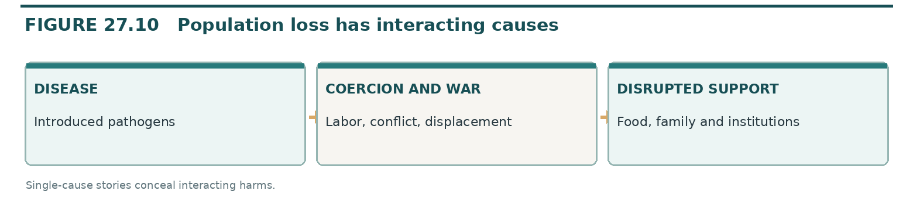

Болестите в Стария свят, въведени в Америка, имат опустошителни последици за местното население, които не са били изложени преди това на някои от тези патогени. Едра шарка и други инфекции са допринесли за демографските бедствия в много региони. Но една проста формула "гермс завладява Америка" може да скрие последиците от принудителен труд, война, изместване, глад, социални затруднения и колониална политика. Времето и балансът на причините варира значително по регион и период. \[<a href="/027-european-maritime-expansion/sources/#source-2" class="cite">2</a>\]\[<a href="/027-european-maritime-expansion/sources/#source-19" class="cite">19</a>\]\[<a href="/027-european-maritime-expansion/sources/#source-20" class="cite">20</a>\]

Демографската реконструкция също изисква внимание. Наблюдателите от 16-ти век не са провеждали съвременни преброявания на предконтактните Америки. Историците и демографите оценяват загубите, като използват списъци с почити, археологически доказателства, екологични индикатори и живи сметки; несигурността е значителна. Широките различия между оценките не трябва да се превръщат в оправдания за отричане на страданието, нито поканите да се повтарят зрелищни фигури, сякаш са точни. \[<a href="/027-european-maritime-expansion/sources/#source-20" class="cite">20</a>\]\[<a href="/027-european-maritime-expansion/sources/#source-28" class="cite">28</a>\]

Епидемията има социални механизми, не само биологични. Хората, които трябва да напуснат фермите или са принудени в мините, може да не могат да поддържат производството на храни. Обществата, които губят старейшини и специалисти, са изправени пред смущения в предаването на знания. Болестта може да се разпространи по търговски или военни пътища, докато колониалната администрация може да влоши последиците си чрез контролиране на движението или налагане на трудови изисквания. Глава 28 ще проучи тези екологични, демографски и материални връзки много по-подробно.

<figure class="figure" id="figure-27-10">

<figcaption>Фигура 27.10. Самопричиняващи се истории прикриват вредите. <a class="figure-anchor" href="#figure-27-10" aria-label="Link to this figure">#</a></figcaption>
</figure>
