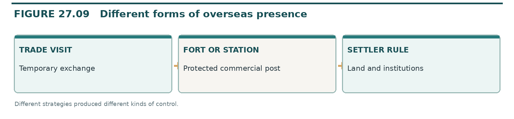

Експедиция може да посети крайбрежието, да обяви притежание и да отплава. Една колония изисквала повтарящи се инвестиции и механизми на управление: заселници, гарнизони, хранителни доставки, поземлени договорености, правни институции и сътрудничество или подчиненост на местното население. Затова създаването на колония промени пътуването от събитие в трайни политически отношения. Процесът беше неравен; империите често се опитваха да претендират, че не могат да налагат поколения наред. \[<a href="/027-european-maritime-expansion/sources/#source-2" class="cite">2</a>\]\[<a href="/027-european-maritime-expansion/sources/#source-10" class="cite">10</a>\]\[<a href="/027-european-maritime-expansion/sources/#source-18" class="cite">18</a>\]

Той помага да се разграничат четири припокриващи се форми на присъствие в чужбина. Сезонната търговска визита зависеше от обмен без постоянен контрол. Подсилен търговски пост се опитва да осигури пристанище или пазар. Заселническа колония се опитвала да задържи и култивира земя с течение на времето. Завоевание държава подчинена съществуващи територии и население на нови управляващи институции. Тези категории не бяха взаимно изключващи се и едно място можеше да се смени между тях. \[<a href="/027-european-maritime-expansion/sources/#source-10" class="cite">10</a>\]\[<a href="/027-european-maritime-expansion/sources/#source-18" class="cite">18</a>\]

Колониалното правило също промени стимулите на хората, които вече присъстват. Някои общности сформираха съюзи, за да се защитят от съседите или да придобият нови стоки; други се съпротивляваха на териториални претенции, изисквания на труда или мисионерски натиск. Някои партньорства по-късно се разпускат, тъй като колониалните власти укрепват. Описвайки цялото сътрудничество като "доброволно приемане" би пренебрегнало неравните алтернативи и променящите се условия. Създаването на империя е дълга поредица от спорни взаимоотношения, а не автоматичен резултат от кацане.

<figure class="figure" id="figure-27-9">

<figcaption>Фигура 27.9. Различни стратегии произвеждат различни видове контрол. <a class="figure-anchor" href="#figure-27-9" aria-label="Link to this figure">#</a></figcaption>
</figure>
