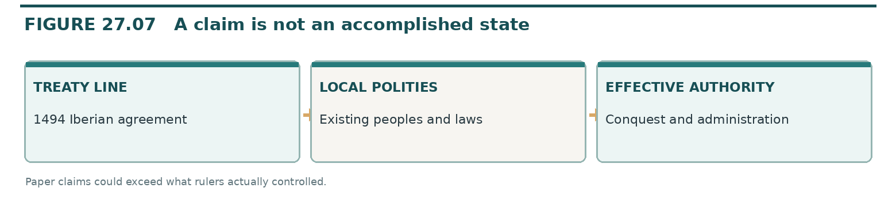

Пътешествията на Колумб първоначално отговаряли на европейските очаквания за Източна Азия. Последвалите експедиции и географските аргументи постепенно изяснили, че големите земни маси се намират между Атлантическия океан и предполагаемата азиатска дестинация. 1507-та световна карта, свързана с Мартин Валдсиймюлер, известна като "Америка," произлизаща от Америго Веспучи, за част от новоизрисуваната земя. Това отразява промяната на европейската интерпретация, нито момент, в който се е появил обитаемият континент. \[<a href="/027-european-maritime-expansion/sources/#source-21" class="cite">21</a>\]\[<a href="/027-european-maritime-expansion/sources/#source-22" class="cite">22</a>\]

Картографията е политически инструмент, както и интелектуална. Печатните карти могат да рекламират претенции, да идентифицират пристанища, да вдъхновяват инвеститорите и да убеждават читателите, че новите територии са на разположение за управление. Картите често привилегирована брегова ивица, известна на моряците, докато интериорните популации са представени с фантастични изображения или пропуснати. Граничната линия, очертана уверено на хартия, не била същата като действителната юрисдикция на земята. \[<a href="/027-european-maritime-expansion/sources/#source-21" class="cite">21</a>\]\[<a href="/027-european-maritime-expansion/sources/#source-22" class="cite">22</a>\]

Обърни внимание какво липсва от картата, показваща само португалски и испански цветове. Тя не може да показва никаква местна полственост, никакво африканско царство и никаква разлика между заявен остров и успешно окупирано пристанище. Това графично опростяване е исторически следствие: читателите могат да сбъркат кралската амбиция за постигнато управление. Да се научиш да четеш картата критично изисква да питаш чии имена са отпечатани, чиито селища са невидими и които твърдят, че създателят на карти е имал интерес към популяризирането.

<figure class="figure" id="figure-27-7">

<figcaption>Фигура 27.7. Твърденията за документи могат да надхвърлят това, което владетелите действително контролират. <a class="figure-anchor" href="#figure-27-7" aria-label="Link to this figure">#</a></figcaption>
</figure>
