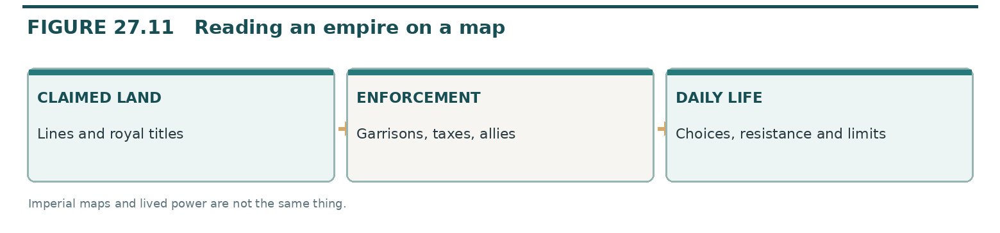

Европейските сили използваха обширен език за господството, изключителната търговия и универсалната монархия, но прилагането на закона варираше значително. Ранните португалски Estado да Índia разчита на разпръснати укрепления, пристанища и проходи в Индийския океан все още доминират в много области от азиатските търговци и владетели. Испанските американски колонии контролират значителни територии, но също така съдържат трайни автономни местни региони и повтаряща се съпротива. И двете правителства зависеха от частно финансиране, местни посредници и ограничен административен капацитет. \[<a href="/027-european-maritime-expansion/sources/#source-4" class="cite">4</a>\]\[<a href="/027-european-maritime-expansion/sources/#source-6" class="cite">6</a>\]\[<a href="/027-european-maritime-expansion/sources/#source-18" class="cite">18</a>\]

Ривалните европейци биха могли да атакуват корабоплаването, да оспорват монополите или да създадат свои собствени чуждестранни предприятия. Крайбрежните африкански и азиатски владетели запазиха силата си в много срещи. Бурите, разходите и съпротивата постоянно разкриват разстоянието между императорските прокламации и ефективната власт. Дори в колониите правилата могат да бъдат договорени, игнорирани или модифицирани от далечни служители. \[<a href="/027-european-maritime-expansion/sources/#source-4" class="cite">4</a>\]\[<a href="/027-european-maritime-expansion/sources/#source-13" class="cite">13</a>\]

Когато изследваш една империя на карта, задаваш три въпроса. Какво се твърди законно? Какво всъщност може да наложи короната? Какво преживявали жителите в ежедневния живот? Тези отговори може да се различават рязко. Империята не беше нито един ключ, който се включи след пътуване; тя беше пластиран, променящ набор от енергийни връзки, разработени чрез търговия, война, селище и администрация.

<figure class="figure" id="figure-27-11">

<figcaption>Фигура 27.11. Имперските карти и живата сила не са едно и също нещо. <a class="figure-anchor" href="#figure-27-11" aria-label="Link to this figure">#</a></figcaption>
</figure>
