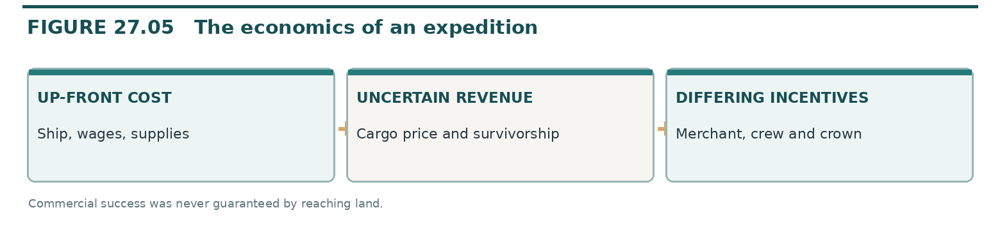

Представете си инвеститор, финансиращ кораб, чиито дървен материал, гребла, оръжия, провизии и заплати на екипажа трябва да бъдат платени преди продажбата на товар. Пътуването отнема много месеци или години. Някои моряци умират; някои стоки развалят; бури или враждебни сили могат да унищожат кораба. Дори успешното пристигане може да разкрие, че планираните стоки не са добре дошли на пазара за дестинация. Следователно печалбите изискват повече от висока цена за пипер или злато в Европа. Те изискват финансиране, застраховка или споделяне на риска, изпълнение на договори и ефективна система от многократни експедиции. \[<a href="/027-european-maritime-expansion/sources/#source-1" class="cite">1</a>\]\[<a href="/027-european-maritime-expansion/sources/#source-6" class="cite">6</a>\]\[<a href="/027-european-maritime-expansion/sources/#source-18" class="cite">18</a>\]

Управителите могат да предоставят монополи и привилегии в замяна на очакваните приходи, но правните титли не премахват риска. Търговци и финансисти предоставят кредитни и технически познания. Короната може да събира стоки или да контролира търговска институция, докато сключва договори с частни оператори. Корабите често пренасяли военни сили, защото държавите се опитвали да извлекат част от търговията, като ограничавали съперниците си. Военните разходи сами по себе си са цена, и конкуренти могат да се избегне или предизвикателство блокада.

Това помага да се обясни защо грандиозните открития не направиха веднага всеки морски спонсор богат. Един успешен маршрут може да банкрутира една конкретна експедиция; силно въоръжена крепост би могла да струва повече, отколкото е събрала; и процъфтяваща търговска система може да облагодетелства по-скоро чуждестранни или местни посредници, отколкото кралска хазна. Ранно разширяване смесено предприемачество, държавни приходи, търсещи и организирани принуда, често в нестабилни пропорции.

<figure class="figure" id="figure-27-5">

<figcaption>Фигура 27.5. Търговският успех никога не е гарантиран чрез достигане на земя. <a class="figure-anchor" href="#figure-27-5" aria-label="Link to this figure">#</a></figcaption>
</figure>
