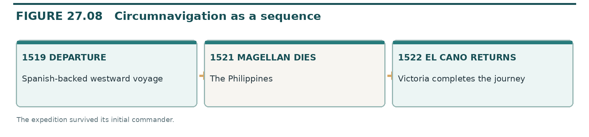

През 1519 г. експедиция, спонсорирана от испанската монархия, потеглила под командването на Фердинанд Магелан - португалски навигатор. Целта му включвала достигането на островите, които произвеждат подправки в Югоизточна Азия, като плават на запад. Флотът прекоси Атлантическия океан, премина през протока на южния връх на Южна Америка, сега свързан с Магелан, и влезе в Тихия океан. Това огромно пресичане разкрило сериозните грешки в предишните оценки на океанските разстояния на планетата. Магелан е бил убит във Филипините през 1521. Останалото пътуване е завършено от кораба Виктория под управлението на Хуан Себастиан Елкано през 1522 г. \[<a href="/027-european-maritime-expansion/sources/#source-25" class="cite">25</a>\]\[<a href="/027-european-maritime-expansion/sources/#source-26" class="cite">26</a>\]

Обиколката, установена чрез пряк опит в плаването, че непрекъснато пътуване по целия свят е възможно, въпреки че сферична форма на земното кълбо е била приета в научих традиции много преди. Той също драматизира разликите между обещанието на картата и телесните разходи за пътуване. Круз се сблъскал с недостиг, болест, конфликт и загуба на кораби. Местните общества, срещани по маршрута, имаха свои съюзи и политически съперници; те не бяха пейзажи за европейска демонстрация. \[<a href="/027-european-maritime-expansion/sources/#source-25" class="cite">25</a>\]\[<a href="/027-european-maritime-expansion/sources/#source-26" class="cite">26</a>\]

Историята често се обобщава като "Магелан плава по целия свят." Това е неточно, ако това означава, че Магелан лично е завършил пътуването. Историците могат да признаят ролята му в организирането и воденето на първите етапи, докато кредитира Елкано и оцелелите членове на екипажа с завършване на обиколката. Тази малка корекция илюстрира как историческата памет може да концентрира колективно постижение в едно прочуто име.

<figure class="figure" id="figure-27-8">

<figcaption>Фигура 27.8. Експедицията е оцеляла след първоначалния командир. <a class="figure-anchor" href="#figure-27-8" aria-label="Link to this figure">#</a></figcaption>
</figure>
