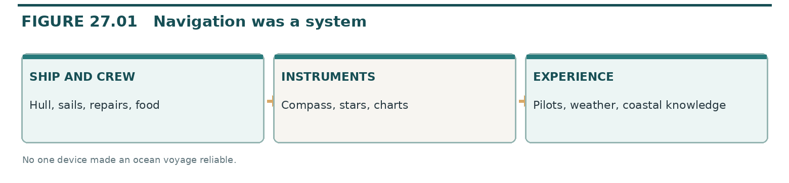

Прекосяванията на океана изискваха кораби, платна, рулове, гребла, карти, практична астрономия, натрупан опит в плаването и хора, способни да поправят оборудване. Морските пехотинци използват магнитни компаси, мъртва разплата, звукови линии и наблюдения на Слънцето или звездите. Навигацията се развива кумулативна от Средиземно море, Атлантическия океан, ислямските и други традиции. Корабостроенето също адаптира наследени форми: караваните са били полезни за някои изследователски и крайбрежни дейности, докато по-големите Naus или carracks пренасят значителни товари по дълги маршрути. Само по себе си не е възможно да се извършва самостоятелно проучване на един кораб или инструмент. \[<a href="/027-european-maritime-expansion/sources/#source-5" class="cite">5</a>\]\[<a href="/027-european-maritime-expansion/sources/#source-8" class="cite">8</a>\]\[<a href="/027-european-maritime-expansion/sources/#source-9" class="cite">9</a>\]

Капитан с точен компас не е знаел автоматично къде е корабът. Географската ширина понякога може да бъде оценена чрез астрономически наблюдения; определяне на дължина точно остана много по-трудно. Мъртво отчитане използва оценка на посоката, скоростта и изминалото време, с грешки, натрупани през несигурни течения и времето. Морските карти представляват познание в определен момент, а не универсална истина. Бреговата линия, маркирана уверено, може да прикрие опасна пясъчна банка; празната зона на карта би могла да означава малко повече от празнина в информацията на картографа. \[<a href="/027-european-maritime-expansion/sources/#source-8" class="cite">8</a>\]\[<a href="/027-european-maritime-expansion/sources/#source-9" class="cite">9</a>\]

Също толкова важни били готвачите, дърводелците, платнарите, преводачите, пилотите и обикновените моряци. Повредена мачта или развалена вода може да сложи край на едно пътуване, което изглеждало успешно на земното кълбо. Експедицията беше логистична и социална организация, а не просто прочуто име на кърмата на кораба. Този урок се свързва с военната логистика, обсъждана в глава 22.

<figure class="figure" id="figure-27-1">

<figcaption>Фигура 27.1. Никой не е направил пътуването до океана надеждно. <a class="figure-anchor" href="#figure-27-1" aria-label="Link to this figure">#</a></figcaption>
</figure>
