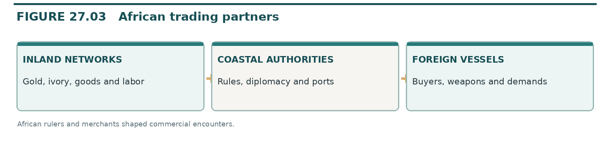

Докато португалските кораби плавали по-далеч по западноафриканското крайбрежие, те срещали общества с политически структури, търговски практики и връзки, достигащи до вътрешността на страната. Търговията със злато, слонова кост, пипер, текстил и други стоки отдавна подкрепяше африканските мрежи, включително маршрутите през Сахара. Португалските търговци можели да търсят нови преки взаимоотношения, но не просто притежавали африкански икономически системи. Местните управници регламентират достъпа, определят условия, използват европейски стоки стратегически и понякога отхвърлят чужди искания. \[<a href="/027-european-maritime-expansion/sources/#source-6" class="cite">6</a>\]\[<a href="/027-european-maritime-expansion/sources/#source-12" class="cite">12</a>\]\[<a href="/027-european-maritime-expansion/sources/#source-13" class="cite">13</a>\]

Кралство Бенин например се занимава с португалски посетители, докато политическото му ръководство запазва значителна власт върху условията на размяна. Художествени предмети като издълбани волиери и метални изделия разкриват африкански патронаж и опитен майсторство заедно с променящите се външни връзки. В Централна Африка кралство Конго ще развие дипломатически и религиозни отношения с Португалия, докато последващото напрежение излага разликата между партньорство и подчинение. Тези истории не трябва да бъдат компресирани в пасивно "африканско крайбрежие." \[<a href="/027-european-maritime-expansion/sources/#source-12" class="cite">12</a>\]\[<a href="/027-european-maritime-expansion/sources/#source-13" class="cite">13</a>\]\[<a href="/027-european-maritime-expansion/sources/#source-14" class="cite">14</a>\]

Търговията и принуда съществуваха заедно. Португалските нападения и покупки на пленници допринесоха за разработването на системи за поробване на Атлантическия океан, въпреки че техният характер и мащаб се промениха с течение на времето. Местните африкански актьори заемали различни позиции като владетели, брокери, пленници, противници и членове на домакинството. Да се отбележи, че участието на Африка в търговските мрежи не означава да се заличи отговорността на европейските купувачи, корабособственици и правителства за разширяване на принудителните пазари. От друга страна, за да се опише европейското насилие, не е необходимо африканските държави да бъдат третирани като неспособни на дипломация или съпротива. \[<a href="/027-european-maritime-expansion/sources/#source-15" class="cite">15</a>\]\[<a href="/027-european-maritime-expansion/sources/#source-16" class="cite">16</a>\]

<figure class="figure" id="figure-27-3">

<figcaption>Фигура 27.3. Африкански владетели и търговци оформят търговски срещи. <a class="figure-anchor" href="#figure-27-3" aria-label="Link to this figure">#</a></figcaption>
</figure>
