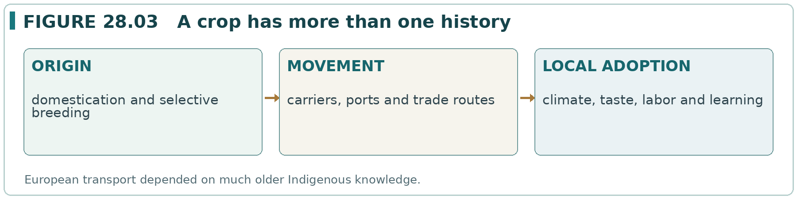

Много телбоди сега смятат, че централно за световната кухня произхожда от Америка. Царевица, картофи, Касава, сладки картофи, домати, какао, чили, фъстъци, няколко зърна и сортове тикви пътуваха в други региони. Не всяко разнообразие от боб или скуош споделят един произход; ботаническа история е по-прецизно, отколкото списък за пазаруване. Тяхната дифузия зависела от фермерите, които разбирали сеитба, почвите, спестяването на семена, готвенето и рисковете от непознати растения.

Защо тези култури били ценни? Някои осигуряват високи добиви на енергия при подходящи условия. Други пълни екологични ниши, които местните скоби не заемат или могат да бъдат събрани по различно време на годината. В някои региони една нова реколта допълва пшеница или просо; в други тя променя баланса на земеделието. Фермерът може да предпочита царевица на склона, касава в почви, неподходящи за съществуващи култури или сладки картофи, които предлагат храна по време на уязвим сезон. Нито една култура обаче не гарантира просперитет: реколтата може да се провали, патогените атакуват и земята мандат или политическо насилие могат да блокират достъпа до храна.

Прост географски тест разкрива мащаба на промяната. Съвременните италиански доматни ястия, южноазиатското чили-богато готвене и много африкански царевични ястия са възникнали през вековете на адаптация след 1492. Тези кухни са не по-малко автентично местни, защото ключова съставка някога дойде от другаде. Културната идентичност се развива чрез избор, рецепти и институции, не само родното място на растението. \[<a href="/028-the-columbian-exchange/sources/#source-2" class="cite">2</a>\]\[<a href="/028-the-columbian-exchange/sources/#source-6" class="cite">6</a>\]

<figure class="figure" id="figure-28-3">

<figcaption>Фигура 28.3. Европейският транспорт зависеше от много по-старите местни знания. <a class="figure-anchor" href="#figure-28-3" aria-label="Link to this figure">#</a></figcaption>
</figure>
