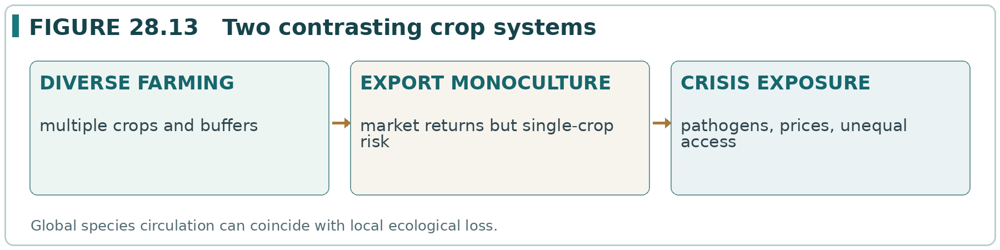

Движението на културите увеличава броя на потенциално сектируемите видове, налични в много региони. Един фермер в Европа впоследствие получил достъп до картофи, домати и царевица, докато едно американско селище придобило пшеница, добитък и захарна тръстика. Това може да увеличи възможностите за калории, вкусове и препитание. Но разширяването на големите имоти и монокултурите едновременно може да намали местното разнообразие.

Да разгледаме две хипотетични долини. Долина А отглежда няколко местни адаптирани култури и приема малки количества от нова грудка, като разнообразява хранителните си запаси. Valley B изчиства смесен пейзаж за култивиране на една експортна култура, като става силно зависима от единен пазар и уязвима към болести по културите. И двамата участват в Колумбийската борса; тяхната екологична устойчивост може да се движи в противоположни посоки.

Урокът не е, че размяната по същество е добра или лоша. Въвеждането на видовете си взаимодейства с институциите, натиска върху населението, търговските стимули и управленските практики. По-голямото глобално разпространение не означава непременно по-голямо биологично разнообразие или справедлив достъп до храна.

<figure class="figure" id="figure-28-13">

<figcaption>Фигура 28.13. Глобалното разпространение на видовете може да съвпадне с местната екологична загуба. <a class="figure-anchor" href="#figure-28-13" aria-label="Link to this figure">#</a></figcaption>
</figure>
