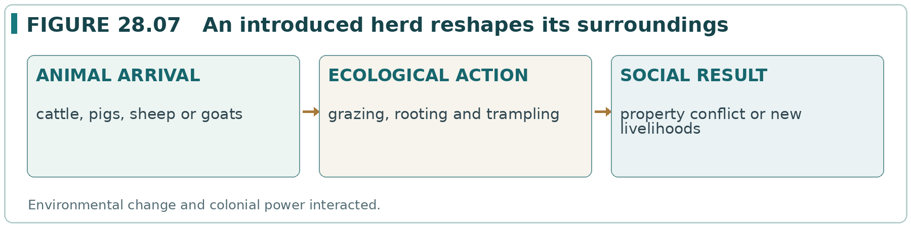

Европейските колонисти пренасят добитък, овце, свине и кози до островите и континентите на Америка. Тези животни доставят месо, кожи, мляко, транспорт или пазарна стойност. Освен това те се хранели с растения, стъпкали ниви и сменили растителността. Прасетата могат да станат диви, докато тревопасните животни могат да се конкурират със съществуващите диви животни и да променят почвите и водните пътища в някои пейзажи.

Ефектът на добитъка зависел от това къде и как са били възкресени. Контролираното стадо на подходящи пасища е различно от животните, които се размножават в уязвими островни екосистеми. Земевладелците може да виждат изобилието от добитък като просперитет, докато близките местни фермери могат да изпитат унищожение на културите и загуба на достъп до територията. Историята на животните следователно принадлежи към историята на закона, собствеността и властта. \[<a href="/028-the-columbian-exchange/sources/#source-13" class="cite">13</a>\]

Не е правилно да се каже, че преди контакта американците не са имали домашни животни. Llamas и alpacas в Андите, кучета в много региони и пуйки в Месоамерика са ясни контрапримери. Това, което се различаваше, беше конкретния пакет от големи евразийски пасища и проекти на животни, въведени чрез колониално селище. Описвайки точно тези различия, е по-светло от класацията на континентите като технологични по-високи или по-ниски.

<figure class="figure" id="figure-28-7">

<figcaption>Фигура 28.7. Промяната в околната среда и колониалната енергия взаимодействат. <a class="figure-anchor" href="#figure-28-7" aria-label="Link to this figure">#</a></figcaption>
</figure>
