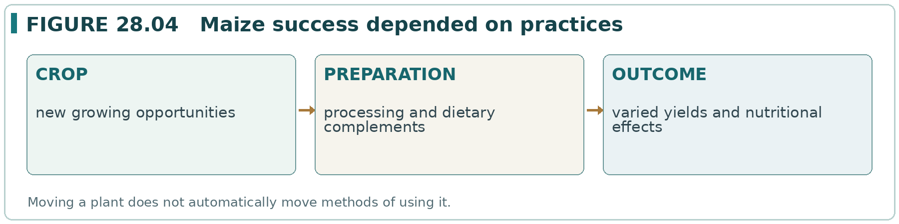

Царевицата е опитомена в Месоамерика през много поколения, след което се разпространява широко в рамките на Америка преди европейски контакт. Тя достигна до части от Европа, Африка и Азия по няколко маршрута след 1492 г. В благоприятни климатични условия тя може да произвежда значителни реколти и хората го включват в съществуващи области, ротационни процеси и хранителни култури. Неговият глобален успех е резултат от местното развитие на културите, съчетано със знанията и труда на по-късните фермери по света.

В Африка царевицата станала важна в много региони, но не просто заменила всички местни основни фактори. Соргото, просото, картофите и африканският ориз продължиха да имат значение. Някои общности приеха царевица, тъй като тя узрява бързо или подходящо време за отглеждане; други политически и икономически промени влияят на това дали тя става доминираща. Историческите изследвания показват, че ефектите му са варирали рязко по регион и период. Изявленията, че царевицата сама по себе си е причинила растежа на африканското население или конфликт, са твърде тъпи за доказателствата. \[<a href="/028-the-columbian-exchange/sources/#source-7" class="cite">7</a>\]

Храненето представлява друг важен проблем. В много мезоамерикански култури царевицата е обработена с алкални вещества по начини, често описани като никстализация, подобряване на хранителната наличност и други свойства. Новоприетата царевица не винаги е приемала едни и същи методи за приготвяне. При диета, която е изключително зависима от лошо обработена царевица, хранителните недостатъци могат да се превърнат в проблем на общественото здраве. Движението на културите и движението на знанията за използването им са различни исторически процеси.

<figure class="figure" id="figure-28-4">

<figcaption>Фигура 28.4. Преместването на растение не се движи автоматично методи за използването му. <a class="figure-anchor" href="#figure-28-4" aria-label="Link to this figure">#</a></figcaption>
</figure>
