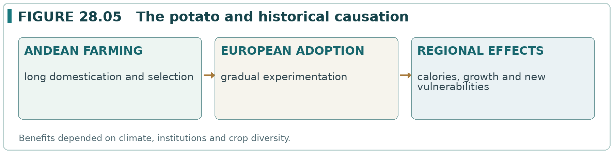

Хайландските общности в Андите опитомяват и диверсифицират картофите много преди да пристигнат европейците. Фермерите селектирани сортове за височина, скреж толерантност, съхранение и вкус; някои разработени методи за съхранение като замразяване-сух в Чуньо. Картофът не излезе от нито един героичен изследовател. Това било голямо местно земеделско постижение, пренесено в един по-широк свят при колониални условия. \[<a href="/028-the-columbian-exchange/sources/#source-8" class="cite">8</a>\]\[<a href="/028-the-columbian-exchange/sources/#source-9" class="cite">9</a>\]

Картофите достигат Европа през шестнадесети век, но широкото осиновяване на много места отне много повече време. Непозната култура за фермерите и готвачите изисквали нови методи, доверие, запаси от семена и благоприятни условия за отглеждане. Когато е успял, картофите са предлагали калории от относително малки площи, подкрепяли са някои растящи популации и са създали алтернативи, когато реколтата на зърнени култури се е провалила. Икономистите Нейтън Нън и Нанси Циан откриха доказателства, свързващи разпространението на картофите със значителен принос към населението на Стария свят и урбанизацията в исторически анализ. Това е аргумент за средния дългосрочен ефект, а не гаранция, че всяка област се ползва еднакво. \[<a href="/028-the-columbian-exchange/sources/#source-10" class="cite">10</a>\]

Картофът също илюстрира опасността от стесняване на разнообразието на културите. Деветнадесети век зависимостта на Ирландия от уязвимите сортове картофи, съчетана с политически и икономически условия, допринесла за катастрофата на Големия глад след появата на картофената болест. Тази по-късна история не отменя по-ранните ползи на картофа. Тя показва, че продоволствената сигурност зависи от социалните договорености, разнообразието на културите и достъпа до ресурси, а не само от добива.

<figure class="figure" id="figure-28-5">

<figcaption>Фигура 28.5. Ползите зависят от климата, институциите и разнообразието на културите. <a class="figure-anchor" href="#figure-28-5" aria-label="Link to this figure">#</a></figcaption>
</figure>
