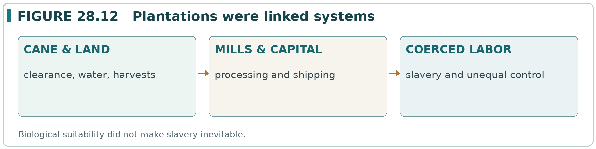

Sugarcane илюстрира верига от промени, а не отделна сделка със стоки. Бастунът се нуждае от подходяща топлина, вода и обширен труд за отглеждане и преработка. Плантацията изисквала земя, мелници, гориво, транспорт и работна сила, принудена или наета при определени режими. Когато производството на захар се разширява в тропически американски колонии, то може да доведе до прочистване на гори, променени водни пътища и зависимост от експортните пазари.

Следователно размяната на растения промени движението на капитали и хора. Търсенето на европейски и други пазари насърчи инвестициите в мелници и корабоплаване; печелившият износ стимулира по-нататъшното разширяване; принудителната работна сила беше подложена на брутална експлоатация. Производството на плантации свързва биологичните възможности с институциите за собственост, кредити и насилие.

Това води до полезни резултати: ако захарната тръстика не е била биологично способна да расте в карибска среда, икономическата история на региона може да се е развила по различен начин. Но съществуването на подходящ климат не диктува робството. Институциите, колониалната политика, търговските стимули и съпротивата определят как е било организирано самоусъвършенстването. Околната среда ограничава историята; тя не пише моралния избор на владетели и търговци.

<figure class="figure" id="figure-28-12">

<figcaption>Фигура 28.12. Биологичната годност не направила робството неизбежно. <a class="figure-anchor" href="#figure-28-12" aria-label="Link to this figure">#</a></figcaption>
</figure>
