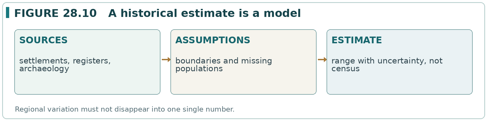

Широкото заключение е сигурно: много местни общества понесоха извънредни загуби на населението през века или повече след траен европейски контакт. Точният размер на населението преди 1492 г. и общото изгубено съотношение остават спорни, тъй като данните от преброяването са непълни и поради това различните региони са се свързвали по различно време. Изследователите съчетават археологически доказателства за селище, по-късни регистри на данъците, модели за използване на земята и ретроспективни демографски модели. \[<a href="/028-the-columbian-exchange/sources/#source-18" class="cite">18</a>\]

Един влиятелен синтез за 2019 г. изчислява приблизително 60.5 милиона души в цяла Америка преди големи загуби след 1492 г., със значителен интервал на несигурност, и моделира много голям спад през следващия век. Това са проучвания, а не преброяване. Би било подвеждащо да се превърне централната стойност на една книга в безспорен факт или да се предположи, че всяка местност е загубила един и същ процент. Изчисленията за отделните общества и интервалите се различават, а методите остават дискутирани. \[<a href="/028-the-columbian-exchange/sources/#source-19" class="cite">19</a>\]

Втора опасност е разказът за неизбежно изчезване. Местните американци не са изчезнали. Техните потомци присъстват в цялото полукълбо; общностите оцеляха, съпротивляваха се, интегрираха нови практики и запазени езици и знания. Демографският упадък е история на насилие и болести, а не твърдение, че цели народи са престанали да съществуват.

<figure class="figure" id="figure-28-10">

<figcaption>Фигура 28.10. Регионалното изменение не трябва да изчезва в едно единствено число. <a class="figure-anchor" href="#figure-28-10" aria-label="Link to this figure">#</a></figcaption>
</figure>
