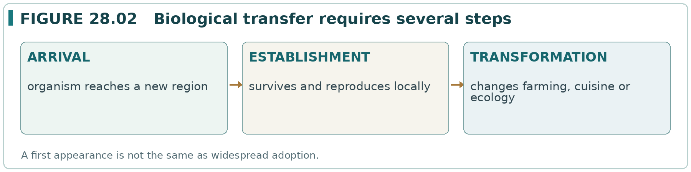

Дългото географско разделение е довело до движението на някои организми, особено след това. Биологичните общности са развили различни комбинации от конкуренти, хищници, патогени и опитомяващи животни. Когато даден организъм премине в нова среда, той може да срещне подходящи почви, по - малко познати врагове или нов набор от домакини. Но успешното установяване никога не е автоматично. Климатът, продължителността на деня, надморската височина, болестите, животновъдството и културните предпочитания са от значение.

Атлантика не е единствената бариера в световната история. Преди шестнадесети век азиатските и африканските култури прекосявали моретата и керваните в продължение на хилядолетия: захарна тръстика, цитруси, банани и много други растения имали сложни миграции. Глава 26 описва мрежите от Индийския океан и глава 27 описва европейското морско разширяване. Колумбийският обмен не е изобретил екологичното движение на дълги разстояния; той свързва полусфери, които рядко са участвали в същите рутинни биологични кръгове.

Полезна разлика е между въвеждане, установяване и трансформация. Доматното семе в градината е въведение. Многократното отглеждане в подходящи области е установяването. Включването му в регионални кухни, пазари и традиции за селекция е трансформация. Датите за тези фази не са взаимозаменяеми и опростените диаграми често погрешно ги правят едновременно.

<figure class="figure" id="figure-28-2">

<figcaption>Фигура 28.2. Първото появяване не е същото като широко разпространено осиновяване. <a class="figure-anchor" href="#figure-28-2" aria-label="Link to this figure">#</a></figcaption>
</figure>
