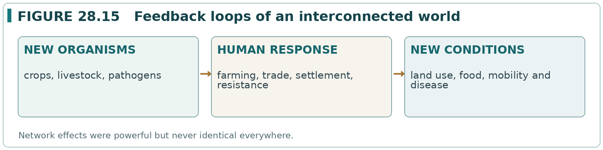

Колумбийската борса е особено подходяща за мислене на системите. Една нова култура може да увеличи хранителните доставки в някои условия, подпомагайки растежа на населението. Повече хора могат да разчистят допълнителна земя и да разширят търговията. Търсенето на износ може да доведе до плантации и принудителен труд. Преобразуването на земята може да промени местообитанията и излагането на болести, влияейки върху по-нататъшното движение на хората. Всеки елемент засяга другите, вместо да функционира в една права линия.

Обратната връзка може да бъде подсилваща или ограничаваща. Успешните картофени реколти насърчават повече засаждане; твърде многото разчитане на едно податливо разнообразие увеличава уязвимостта да се разболее. Броят на едрия рогат добитък се увеличава при благоприятни условия; прегражденията разпадат пасищата, които ги поддържат. Новите пристанища привличат търговци; след това инфекциите могат да се разпространяват по същите мрежи, които пренасят доставки.

Този подход прави фразата "размяната промени света" аналитично полезна. Тя пита чрез кои механизми, за кого и при какви условия настъпи промяната. Историческо обяснение става по-мощно, когато показва линкове, отколкото изброяване на резултатите.

<figure class="figure" id="figure-28-15">

<figcaption>Фигура 28.15. Мрежовите ефекти са мощни, но никога идентични навсякъде. <a class="figure-anchor" href="#figure-28-15" aria-label="Link to this figure">#</a></figcaption>
</figure>
