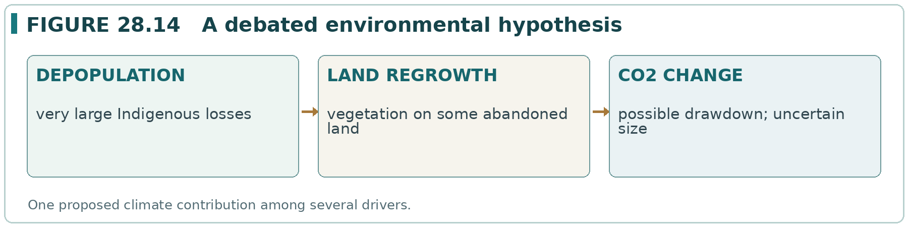

Една провокативна област на научните изследвания изследва дали огромният спад на населението в Америка е помогнал да се отрази на глобалната среда. Когато земеделската земя била изоставена в някои райони, растителността можела да рекултивира и да извлече въглероден диоксид от атмосферата. Едно проучване за моделиране през 2019 г. предложи този процес да допринесе за измеримо намаляване на въглеродния диоксид в атмосферата, свързано с ранния съвременен климатичен рекорд. \[<a href="/028-the-columbian-exchange/sources/#source-19" class="cite">19</a>\]

Това не е уговорено доказателство, че местното обезлюдяване е причинило малката ледникова епоха. Вариациите в климата имат множество двигатели, включително вулканични изригвания, слънчева вариабилност, динамика на океанската атмосфера и вътрешна променливост. Прогнозите за земеползването и въглерода в проучването зависят от несигурни демографски и екологични допускания. Повторение на номера си без интервали ще направи активен изследователски въпрос изглежда по-сигурна, отколкото е.

По-дълбокото значение е, че хората вече са трансформирали американските пейзажи преди колонизацията. Тяхното земеделие, изгаряне и управление на земята оказвали влияние върху растителността. Поради това загубата на живот би могла да има последици за околната среда в мащаби, които се откриват чрез по-късни научни методи. Миналото беше взаимодействие на човешките и естествените системи, а не сцена, на която само политиката действаше.

<figure class="figure" id="figure-28-14">

<figcaption>Фигура 28.14. Един предложи принос за климата сред няколко водачи. <a class="figure-anchor" href="#figure-28-14" aria-label="Link to this figure">#</a></figcaption>
</figure>
