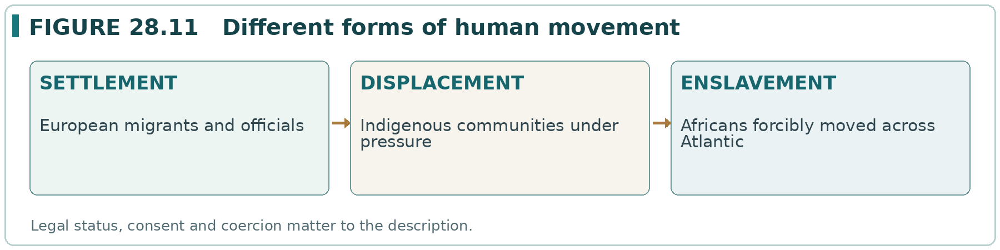

Размяната включваше движение на хора, както и растения и микроби. Европейски заселници, войници, духовници и търговци прекосиха Атлантическия океан. Африканците били транспортирани в нарастващи количества чрез принудителни системи, които се разширили в огромна трансатлантическа търговия с роби. Местните американци са имали насилствено изместване, миграция, война и реорганизация на селищата. Нито едно от тези движения не може да бъде заснето само с думата "миграция."

Демографската катастрофа в много местни региони беше свързана с нарастващите изисквания за труд и земя. Собствениците на плантации и императорски служители привлякоха поробените африканци с разширяването на системите за производство на захар, миньорство и колониално селище. Робството предопределило разпространението на Атлантика в различни части на света, но системата на Атлантическия океан се превърнала в различен, мащабен режим на расово наследствено робство. Пълната му история е предмет на глава 29.

Човешките същества също са преместили знанието. Африканските фермери носеха опит в културите и напояването; местните специалисти учеха новодошлите за американските почви и лекарства; европейските занаятчии донесоха техники и институции, които бяха променени в колониални условия. Тези взаимодействия са неравни и често насилствени, но нито едно от участващите популации не е било просто пасивни носители на културата. \[<a href="/028-the-columbian-exchange/sources/#source-11" class="cite">11</a>\]\[<a href="/028-the-columbian-exchange/sources/#source-22" class="cite">22</a>\]

<figure class="figure" id="figure-28-11">

<figcaption>Фигура 28.11. Правен статут, съгласие и принуда към описанието. <a class="figure-anchor" href="#figure-28-11" aria-label="Link to this figure">#</a></figcaption>
</figure>
