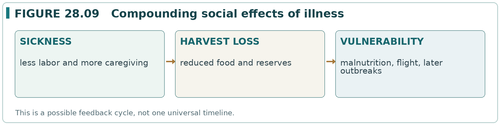

Епидемия убива и деактивира хората, но последствията от нея надхвърлят индивидуалните болести на пациента. Представете си един земеделски район, в който много възрастни се разболяват по време на засаждане. Полетата може да не са сами; оцелелите роднини трябва да се грижат за децата и болните; недостигът на храна може да последва; търговията и отбраната отслабват. Последвалите огнища удрят населението, което вече е подчертано от недостиг и изместване. Ефектите могат да бъдат кумулативни, а не еднократно шокиране.

Загубата на специалисти, лечители, старейшини, фермери, занаятчии, преводачи и политически лидери също застрашава предаването на знания. Някои церемонии и устни истории стават по - трудни за поддържане, когато общностите преживяват повтаряща се загуба. Въпреки това хората адаптираха, реорганизираха родствените връзки, преместваха се, развиваха нови институции и поддържаха културни практики. Историята на епидемичните катастрофи трябва да запази оцеляването и агенцията.

Епидемиологичните обяснения не опрощават завоевателите. Принудително презаселване, трудови проекти, насилие, сексуална експлоатация и унищожаване на хранителни системи засили уязвимостта в много региони. Болестта и принуда били заплетени. Да кажем "болестта е причинила колапса," без да питаме за колониалната политика, рискувайки да скрием как човешките избори са направили огнищата по-смъртоносни. \[<a href="/028-the-columbian-exchange/sources/#source-15" class="cite">15</a>\]\[<a href="/028-the-columbian-exchange/sources/#source-17" class="cite">17</a>\]

<figure class="figure" id="figure-28-9">

<figcaption>Фигура 28.9. Това е възможен цикъл на обратна връзка, а не една универсална времева линия. <a class="figure-anchor" href="#figure-28-9" aria-label="Link to this figure">#</a></figcaption>
</figure>
