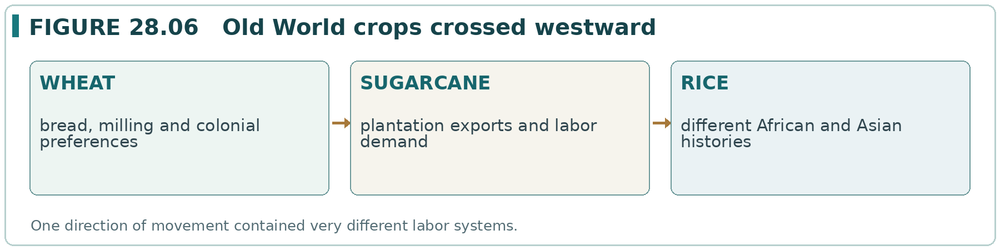

Старият свят е прекосил и Америка. Пшеница, ечемик, цитрусови плодове, грозде, захарна тръстика и някои сортове ориз са били засадени в колониални условия, въпреки че осиновяването е зависело от климата и достъпа до земя. Пшеницата се свързва в много испански колониални области с европейските традиции и религиозни практики. Тези култури са пристигнали сред установени местни царевица, боб, тиква и корен-crop системи, вместо да ги замени навсякъде.

Sugarcane е преминал през Южна и Югоизточна Азия и след това много преди 1492. Самоусъвършенстването му в Атлантическите острови помогна за разработването на модели на интензивно производство на износ, капиталови инвестиции и принудителен труд, които се разшириха в Карибите и Бразилия. Захарта е променила крайбрежните пейзажи чрез прочистване на земята и търсене на вода. Нейната продукция е стигнала до потребителите през океаните, докато тежките разходи за труд са понасяни от хората в плантациите, включително и поробените африканци. Глава 29 изследва Атлантическо робство по-директно, но биологичната география на захарта принадлежи тук. \[<a href="/028-the-columbian-exchange/sources/#source-11" class="cite">11</a>\]\[<a href="/028-the-columbian-exchange/sources/#source-12" class="cite">12</a>\]

Оризът разказва по-сложна история от "европейците, въвеждащи ориз." Азиатският ориз и африканският ориз били отделно опитомявани и поробени африканци транспортирали както трудовия, така и селскостопанския опит в части от Америка. Изследванията продължават с това как определени оризови традиции достигат до различни колониални региони. Признаването на поробеното познание на хората поправя разказите, които ги свеждат до анонимни работници.

<figure class="figure" id="figure-28-6">

<figcaption>Фигура 28.6. Една посока на движение съдържаше много различни трудови системи. <a class="figure-anchor" href="#figure-28-6" aria-label="Link to this figure">#</a></figcaption>
</figure>
