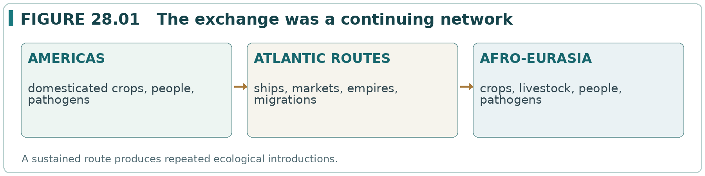

Историкът Алфред Кросби популяризира термина Колумбийски обмен в едно забележително проучване от 1972 г. Тя се отнася до прехвърлянето на живи организми и последиците от тях между Америка и Афро-Евразия след 1492 г.: култури, плевели, добитък, насекоми, патогени и човешки популации, наред с технологиите, идеите и навиците. Името бележи началото на трайната атлантическа връзка, а не твърдението, че Колумб е разбрал света, в който е влязъл или създал цивилизациите си. \[<a href="/028-the-columbian-exchange/sources/#source-1" class="cite">1</a>\]\[<a href="/028-the-columbian-exchange/sources/#source-3" class="cite">3</a>\]

Преди 1492 г. Атлантик разделя два големи биологични свята, чиито истории не са били напълно изолирани. Имало е по-ранен скандинавски контакт със Северна Америка; Местните американски общества са имали обширни търговски маршрути и са управлявали много среди; хората са се разпръснали през Тихия океан. Но един траен, голям трансатлантически кръг от кораби, заселници, провизии и товари се появил едва след Иберийските пътешествия. Важното е да се поддържа контакт: един изолиран кораб може да транспортира семена; постоянните мрежи многократно преместват растения, животни, хора и болести.

Самата дума изисква грижи. Размяната може да звучи доброволно и балансирано, но процесите бяха дълбоко неравни. Един вид може да премине през търговията; друг чрез кражба или задължителна плантация труд; един патоген може да пътува без никой да разбере присъствието му. Концепцията е полезна именно защото организмите пресичат политическите граници и променят живота по начин, който нито владетелите, нито търговците контролират изцяло.

<figure class="figure" id="figure-28-1">

<figcaption>Фигура 28.1. Постоянен маршрут води до повторно екологично въвеждане. <a class="figure-anchor" href="#figure-28-1" aria-label="Link to this figure">#</a></figcaption>
</figure>
