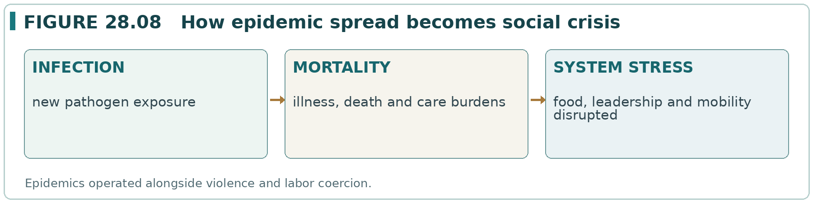

Най-катастрофалните последици от трайния контакт се дължат на епидемиите. Едра шарка, морбили, грип и други инфекции се разпространяват сред популациите, свързани с историята на Афро-Еврозите и разпространени в американски общности с различна история на експозиция. Много местни популации са изправени пред вълни от болести и смъртност, които подкопават семействата, политическите институции и производството на храни. Смъртта не била ограничена до моментите, когато армиите атакували. \[<a href="/028-the-columbian-exchange/sources/#source-14" class="cite">14</a>\]\[<a href="/028-the-columbian-exchange/sources/#source-15" class="cite">15</a>\]

Патогенът не признава дипломатическо споразумение. Тя се разпространява чрез вериги от човешки контакт, понякога пътува през местни мрежи преди европейска експедиция да се появи в един регион. Но историците трябва да избягват да твърдят, че всяка общност е претърпяла незабавни епидемии след 1492 г.; историята на избухването варира значително и много първи трайни експозиции са настъпили по-късно. Последните регионални проучвания оспорват широки предположения относно еднаквото време. \[<a href="/028-the-columbian-exchange/sources/#source-16" class="cite">16</a>\]

Фразата "няма имунитет" е твърде проста. Човешките имунни защити са сложни; предишна експозиция, хранене, генетични изменения, патогенни характеристики и условия на живот взаимодействат. Населението е имало имунна система и много инфекциозни заболявания преди пристигането на Европа. Това, което често липсваше, беше придобита специфична за патогена защита срещу определени нововъведени инфекции. Това разграничение има значение научно и етично.

<figure class="figure" id="figure-28-8">

<figcaption>Фигура 28.8. Епидемиите действат заедно с насилие и трудова принуда. <a class="figure-anchor" href="#figure-28-8" aria-label="Link to this figure">#</a></figcaption>
</figure>
