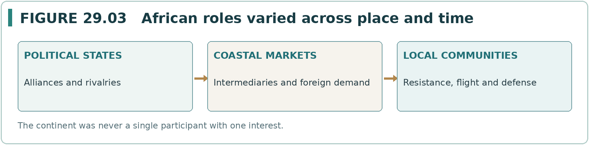

Атлантическият бряг се простираше покрай стотици общества с различни езици, правителства, икономики и интереси. Сенегамските колонии, общностите на Горна Гвинея, Златното крайбрежие, Битката на Бенин, Биарът на Биафра, Западна Централна Африка и части от Югоизточна Африка навлизат в търговията по различни маршрути през четири века. Основните региони, доставящи пленници, се преместиха с течение на времето; също и крайбрежните търговски центрове и отвъдморските дестинации.

Някои африкански политически лидери търсеха вносни оръжия, текстил, метали или други стоки и се замесиха в продажбата на пленници. Някои се борили срещу съперници, конфискували затворници или използвали правни и политически процеси, които били покварени от комерсиалното търсене. Други лидери се съпротивляваха на нападения или се опитваха да регулират или намалят търговията, докато общностите бягаха, укрепваха селищата, преговаряха за защита или търсеха убежище. Вътрешното робство и търговията с роби са реални аспекти от африканската история, но също така са африкански опозиция, стратегии за оцеляване и процъфтяващи политически и културни животи, несвързани с Атлантика система.

Също толкова погрешно е да се твърди, че европейците просто са пленили всеки човек или че само африканците са създали бедствието. Европейските купувачи оформиха търсенето, въоръжени и възнаградени търговски партньори, доставяха морски транспорт и ниско пишеха колониален робски труд. Местните енергийни брокери са имали значение, но са работили вътре, сменяйки принудителните мрежи. Историческата агенция е широко разпространена; отговорността трябва да бъде анализирана, вместо да бъде възложена на въображаем единен континент.

<figure class="figure" id="figure-29-3">

<figcaption>Фигура 29.3. Континентът никога не е бил участник с един интерес. <a class="figure-anchor" href="#figure-29-3" aria-label="Link to this figure">#</a></figcaption>
</figure>
