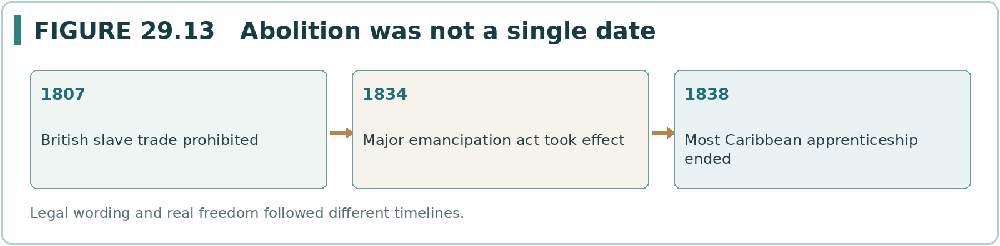

Кампанията срещу търговията с роби на Великобритания се развива чрез религиозен активизъм, черно свидетелство, петиции, бойкоти, парламентарни дебати и организиране на мрежи. Публикуваният разказ на Олауда Еквиано и застъпничеството на поробените преди хора помогнаха да се види насилието в Атлантическия океан пред европейските публика. Кампании като Томас Кларксън и Уилям Уилбърфорс били влиятелни, но една история, организирана единствено около тях, щяла да замъгли централната роля на поробените и бивши роби, както и съпротивата на Карибите, която подкопавала робските системи.

Британия забрани търговията с роби през 1807 г., но този закон не премахна робството в колониите му. Законът за робството от 1833 г. влиза в сила през 1834 г., следван от система за чиракуване, която продължава задължителния труд в голяма част от Британските Карибски острови до 1838 г. Държавата компенсира собствениците на роби в размер на 20 милиона паунда; еманципираните хора не получават сравнима компенсация за поколения неплатен труд. Тези детайли разкриват неравното разпределение на политическата власт дори и при реформа, представена като хуманитарен напредък.

Отпадането било процес на оспорвани закони и прилагане. Търговците търсели вратички, реформаторите настоявали за по-силни мерки и освобождавали хора, които изисквали по-пълни права. Акт, отпечатан в книга със статут, е решаваща историческа повратна точка, но тя не е идентична с живата еманципация.

<figure class="figure" id="figure-29-13">

<figcaption>Фигура 29.13. Правната формулировка и истинската свобода следват различни срокове. <a class="figure-anchor" href="#figure-29-13" aria-label="Link to this figure">#</a></figcaption>
</figure>
