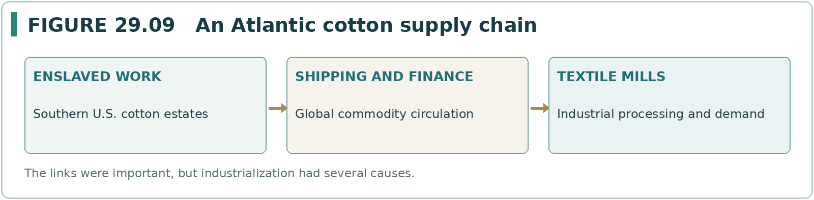

През деветнадесети век памукът, отглеждан от поробени работници в южната част на САЩ, снабдява текстилните индустрии във Великобритания и другаде. Индустриалното предене и тъкане може да увеличи търсенето на сурови влакна; разширеното отглеждане на памук и принудителния труд биха могли от своя страна да доставят фабрики. Това не означава, че робството е причинило индустриализацията сама по себе си. Индустриалният растеж имаше множество източници на промяна, въглища, институции, вътрешни пазари и международни търговски сделки, но робството беше дълбоко свързано с важни промишлени вериги за доставки.

Търсенето на памук насърчаваше разрастването на плантацията в отделните страни, особено когато политиката на САЩ даде възможност за разпадане и уреждане. Поробените семейства също били разделени чрез вътрешен трафик от по-стари райони за отглеждане на роби до нови области с памук. Насилието било институционално, а не случайна черта на няколко необичайно жестоки собственици.

Съвременните икономически дебати питат колко богатство от робството е финансирало конкретни промишлени инвестиции и дали твърденията за национално развитие могат да бъдат количествено определени. Учените не са съгласни с мащабите и причинните механизми. Подсигурената точка е по-скромна и значима: системите обикновено разказват отделно американското робство, европейските текстилни заводи, глобалното финансиране и териториалното разширяване, което се осъществява чрез търговия, политика и принуда.

<figure class="figure" id="figure-29-9">

<figcaption>Фигура 29.9. Връзките бяха важни, но индустриализацията имаше няколко причини. <a class="figure-anchor" href="#figure-29-9" aria-label="Link to this figure">#</a></figcaption>
</figure>
